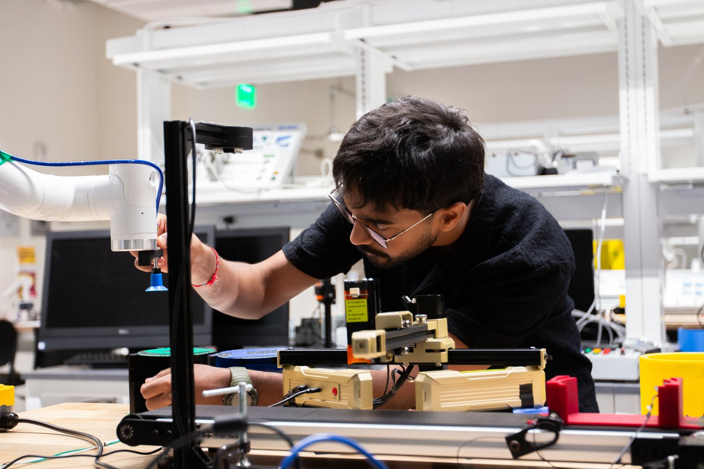
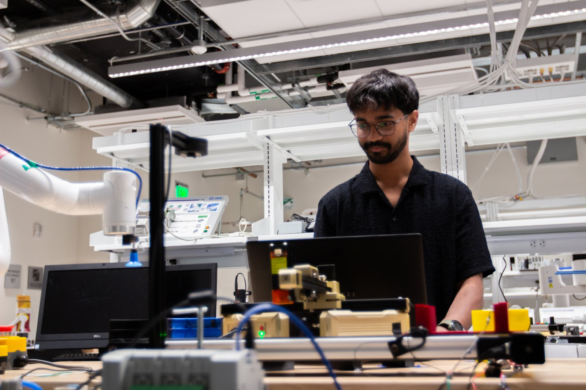
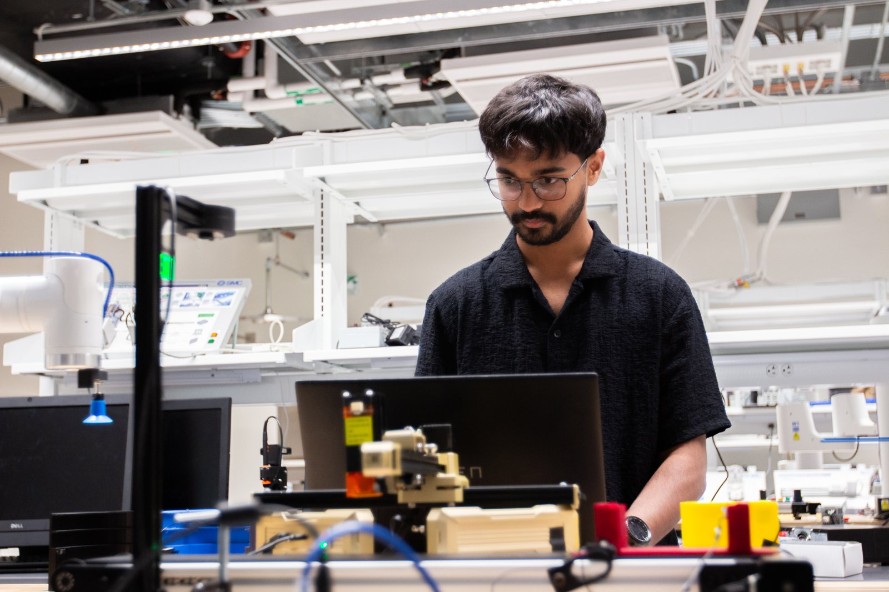
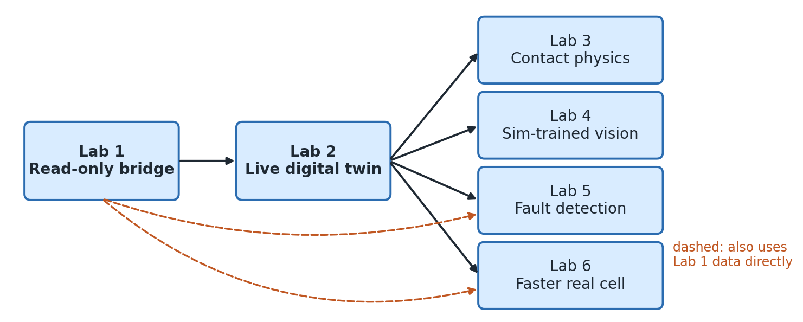
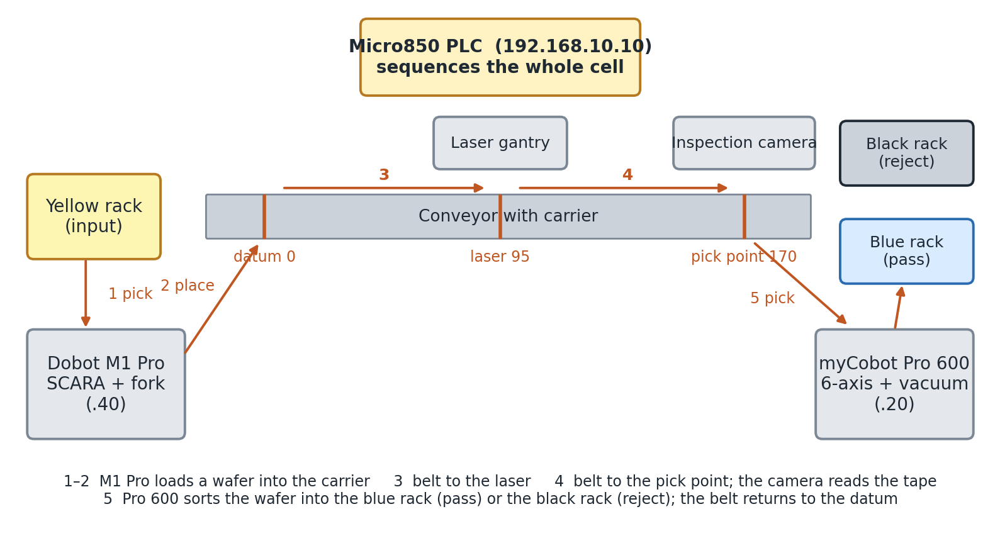
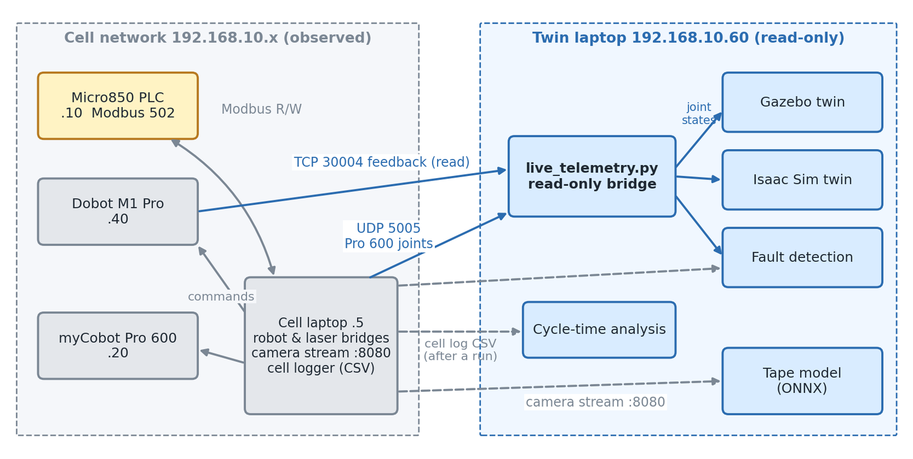

**Code repository:** [JatinSatyam26/wafer-cell-digital-twin](https://github.com/JatinSatyam26/wafer-cell-digital-twin) (commit `75990ed`)  
**Printable manual:** [Full lab manual (PDF)](/assets/Projects/Wafer-Cell-Digital-Twin/pdf/WaferCell_DigitalTwin_LabManual_Full.pdf)  
**Course data:** [course_materials.zip](https://github.com/JatinSatyam26/wafer-cell-digital-twin-labs/releases/download/v1.0/course_materials.zip) (unzip into your home folder as `~/course_materials/`)

## At the Bench





## Course Introduction

This short course is for engineers who want to build and use a **digital twin** of a real industrial robot cell. You need basic Python and Linux. Experience with ROS 2, NVIDIA Isaac Sim or machine learning helps but is not required.

The cell handles glass wafers with two robots, a conveyor, a laser station and an inspection camera, and a PLC sequences it. Over six labs you build a live, read-only twin of that cell. It mirrors both robots in real time, carries the wafers with real contact physics, recognises them with a vision model trained only on synthetic images, detects faults from robot motion alone, and makes the real cell 26 % faster. Each lab adds one layer, and each lab reproduces a result that was measured on the real cell.

The twin never commands the robots or the PLC; it only listens. This rule runs through every lab, and the Safety chapter explains why it matters. The physical cell, its PLC program and its robot bridge scripts existed before this work and are the system the twin observes (see Acknowledgments).

Table 0.1: The six labs

| Lab | What You Do |
|---|---|
| **Lab 1: Reading the Cell** | Stream both robots' joint data into ROS 2 through a read-only bridge, and prove that nothing is ever written to the cell |
| **Lab 2: The Live Digital Twin** | Mirror both robots live in Isaac Sim and Gazebo, and measure how closely the twin tracks the live data (0.50° M1 Pro, 2.20° Pro 600) |
| **Lab 3: Contact Physics** | Carry wafers by contact and friction in simulation, and confirm a predicted 2.6 mm slide on the real cell |
| **Lab 4: Vision Trained in Simulation** | Train a tape classifier only on synthetic images, and score it on real camera images (92.6 %) |
| **Lab 5: Fault Detection from Motion** | Learn what a normal cycle looks like, and detect a stalled robot from motion alone (warning 2.9 s, alarm 5.4 s) |
| **Lab 6: A Faster Real Cell** | Use the twin to find what can overlap, and cut the real cycle from 139.9 s to 103.9 s (−26 %) |


*Figure 0.1: How the labs build on each other*

All code used in the labs is in the project repository: **github.com/JatinSatyam26/wafer-cell-digital-twin**. File paths in the labs are relative to the repository folder unless they start with `~/` (your home folder). The data files for Labs 5 and 6 and the cell's reference files are supplied in the `course_materials` folder that comes with this manual.

## Useful Links and Documentation

All the documentation you need for this course is freely available online. Bookmark these before your first lab session.

Table 0.2: Documentation

| Resource | URL |
|---|---|
| **Project repository (all code and files)** | github.com/JatinSatyam26/wafer-cell-digital-twin |
| **ROS 2 Jazzy documentation** | docs.ros.org/en/jazzy |
| **Gazebo Harmonic documentation** | gazebosim.org/docs/harmonic |
| **NVIDIA Isaac Sim documentation** | docs.isaacsim.omniverse.nvidia.com |
| **Omniverse Replicator (synthetic data)** | docs.omniverse.nvidia.com/extensions/latest/ext_replicator.html |
| **PyTorch torchvision models (ResNet-18)** | pytorch.org/vision/stable/models.html |
| **ONNX Runtime** | onnxruntime.ai/docs |
| **pymodbus (Modbus TCP in Python)** | pymodbus.readthedocs.io |
| **Dobot M1 Pro hardware user guide** | digioptima.eu/wp-content/uploads/2023/10/Dobot-M1-Pro-Hardware-User-Guide.pdf |
| **Dobot M1 Pro ROS package (robot model)** | github.com/Dobot-Arm/M1Pro-ROS |
| **Elephant Robotics Pro600 documentation** | docs.elephantrobotics.com/docs/pro600-en |
| **myCobot ROS 2 package (robot model)** | github.com/elephantrobotics/mycobot_ros2 |

> **Note:** Documentation addresses from manufacturers change between software versions. If a link does not resolve, search for the resource by name.

## The Cell at a Glance

The digital twin in this course mirrors a real two-robot wafer-handling cell in Dr. Sangram Redkar's lab at ASU. The cell, its PLC program and its robot bridge scripts are the system the twin observes (see Acknowledgements). This chapter gives you just enough of the cell to follow the labs.


*Figure 0.2: The wafer-handling cell: stations, robots and the path of one wafer*

### One cycle per wafer

1. The **Dobot M1 Pro**, a SCARA robot with a fork tool, picks a glass wafer from the **yellow rack** (level 1 or level 2) and places it in a carrier on the conveyor.
2. The **conveyor** moves the carrier to the **laser station**. The laser gantry traces a 70 mm square over the wafer. The beam is never fired; the motion only marks the step.
3. The conveyor moves on to the **pick point**. The **inspection camera** classifies the coloured tape on the wafer: blue tape means pass, green tape means reject.
4. The **myCobot Pro 600**, a six-axis robot with a vacuum cup, lifts the wafer off the carrier and places it in the **blue rack** (pass) or the **black rack** (reject).
5. The conveyor returns the carrier to its datum. If more wafers are waiting in the yellow rack, the cycle repeats.

A **Micro850 PLC** runs the sequence as a state machine. Each robot and the laser have a small Python program, called a *bridge*, on the cell laptop. A bridge waits for a command from the PLC, runs the job, and reports its status back. The PLC moves on when a device reports "done".

Table 0.2: The main components

| Component | Role | Address |
|---|---|---|
| Micro850 PLC | Runs the 14-state sequence; Modbus TCP server | 192.168.10.10 |
| Dobot M1 Pro | Loads wafers from the yellow rack into the carrier | 192.168.10.40 |
| myCobot Pro 600 | Sorts wafers into the blue or black rack | 192.168.10.20 |
| Cell laptop | Runs the robot, laser and vision bridges and the cell logger | 192.168.10.5 |
| Twin laptop | Runs the read-only bridge, the twin and the analysis tools | 192.168.10.60 |
| Conveyor | Stepper-driven belt with three stations: datum, laser, pick point | driven by the PLC |
| Inspection camera | USB webcam at the pick point | on the cell laptop |
| Ignition HMI | The operator's screen: start and stop the cell, watch its state | reads and writes the PLC |
| E-stop button | Stops the cell by hand | wired to the cell |

### The handshake between the PLC and a robot

The PLC writes a job number into a robot's command register. The robot's bridge reports *busy* (1) while it works and *done* (2) when it finishes. The PLC then clears the command to 0, and the bridge returns to *idle* (0). Status 99 means a fault and stops the cell. This simple handshake matters in Lab 6, where moving the "done" signal earlier makes the whole cell faster. Appendix A lists every register, and Appendix B lists every step of the sequence.

## Safety

Read this chapter before every lab. The cell contains two industrial robots, a moving belt and a laser gantry. They can move at any time while the cell's bridges are running, including while you are working on the twin.

### General rules

1. **Know the two ways to stop the cell** before the session starts: press the **E-stop button** by hand, or press **Stop on the Ignition HMI** (the cell's operator screen). Locate both, and keep the E-stop button within reach at all times.
2. **Only the instructor starts, stops or resets the cell**, and only when everyone is clear of both robots and the conveyor.
3. **Stay outside the working area** of both robots while the cell is powered, even when it looks idle. A robot can still be finishing a move after the PLC already reports idle (Lab 6 explains why).
4. **Never put a hand on the conveyor, the racks or the carrier** while the cell is running.
5. **Do not change any setting** on a robot controller, the PLC or the cell laptop.

### The read-only rule

The twin and every tool in this course **only read** from the cell. They never send a command. This is a design rule, not a convenience. A second program that writes to a robot or to the PLC can start motion that nobody expects.

Table 0.3: What you may and may not connect to

| Device | Allowed (read-only) | Never |
|---|---|---|
| Dobot M1 Pro (192.168.10.40) | Feedback port **30004** | Dashboard port **29999** and motion port **30003**: they belong to the cell's bridge and can move the robot |
| myCobot Pro 600 (192.168.10.20) | Listening to the bridge's **UDP broadcast on port 5005** | TCP port **5001**: it accepts only one client, and connecting would take control away from the cell's bridge |
| Micro850 PLC (192.168.10.10) | Modbus TCP **reads** on port 502 | Any Modbus **write** (registers or coils), and any program download or upload |
| Cell laptop scripts | — | Running the cell's bridge, laser or logger scripts yourself |

> **Warning:** The repository tool `tools/live/live_telemetry.py` has an option `--pro600-direct` that opens the Pro 600's single-client port 5001. Never use it while the cell's bridge is running. None of the labs need it.

### Laser

The laser module in this cell is disconnected: the gantry moves, but the beam never fires. Treat the gantry as a moving machine all the same.

### Before you leave

Close every program that connects to the cell network, and disconnect your laptop from the cell's switch.

## Network and Data Feeds

All devices sit on one isolated wired network, 192.168.10.0/24, with no gateway and no internet access. The twin laptop joins it with a static address on its wired port and keeps Wi-Fi on its own network.


*Figure 0.3: Data flow from the cell into the twin. Solid arrows are live; dashed arrows are files used after a run*

Table 0.4: Data feeds into the twin (all read-only)

| Source | Port / protocol | Read by | ROS 2 topic |
|---|---|---|---|
| M1 Pro joint feedback | TCP 30004, 1440-byte frames at about 125 Hz | [`tools/live/live_telemetry.py`](https://github.com/JatinSatyam26/wafer-cell-digital-twin/blob/75990ed/tools/live/live_telemetry.py) | `/telemetry/m1pro/joint_states` (`sensor_msgs/JointState`, 50 Hz) |
| Pro 600 joint angles, re-broadcast by the cell's bridge | UDP broadcast 192.168.10.255:5005, JSON, about 20 Hz during motion | [`tools/live/live_telemetry.py`](https://github.com/JatinSatyam26/wafer-cell-digital-twin/blob/75990ed/tools/live/live_telemetry.py) | `/telemetry/pro600/joint_states` (50 Hz) |
| PLC state: sequence step, faults, vision result | Modbus TCP 502, recorded by the cell logger | The cell logger's CSV file, used after a run (Labs 5 and 6) | `/cell/plc_step` in the Gazebo twin's own sequencer |
| Inspection camera | MJPEG stream on port 8080 from the cell laptop | [`tools/bench/live_tape_view.py`](https://github.com/JatinSatyam26/wafer-cell-digital-twin/blob/75990ed/tools/bench/live_tape_view.py) (Lab 4) | — |

### Setting up the twin laptop

Table 0.5: Twin laptop network settings

| Item | Value |
|---|---|
| Interface | Wired Ethernet, patched into the cell's switch |
| Method | Manual (static) IPv4 with NetworkManager |
| Address / mask | 192.168.10.60 / 24 |
| Gateway | None |

Create the wired profile once (replace `<wired-if>` with the name of your wired interface from `ip -br addr`):

```bash
sudo nmcli connection add type ethernet con-name workcell ifname <wired-if> ipv4.method manual ipv4.addresses 192.168.10.60/24 ipv4.never-default yes
sudo nmcli connection up workcell
```

Allow the Pro 600 broadcast through the firewall:

```bash
sudo ufw allow from 192.168.10.0/24 to any port 5005 proto udp
```

> **Tip:** Check: `ip -br addr` shows the wired port UP with 192.168.10.60/24, and `ping -c1 192.168.10.40` gets a reply from the M1 Pro.

## Appendix A: PLC Register Map

The Micro850 PLC at 192.168.10.10 serves these values over Modbus TCP on port 502. The table was generated from the PLC project's Modbus mapping file. The twin only ever **reads** them.

The **protocol address** is the 0-based address that Python libraries such as pymodbus use. For coil n it is n − 1; for holding register 4xxxxx it is 4xxxxx − 400001.

Table A.1: Coils (single bits)

| Coil | Protocol address | Variable | Meaning |
|---|---|---|---|
| 1 | 0 | `Vac_On` | Vacuum on (set by the Pro 600 bridge) |
| 2 | 1 | `Vac_Blow` | Vacuum blow-off pulse (set by the Pro 600 bridge) |
| 3 | 2 | `Start_Cmd` | Start the cycle |
| 4 | 3 | `Fault_Reset` | Reset a fault |
| 5 | 4 | `Fault` | The cell is in fault |
| 6 | 5 | `EStop_OK` | Emergency-stop circuit healthy |
| 7 | 6 | `Yellow_L1` | Wafer on yellow rack, level 1 |
| 8 | 7 | `Yellow_L2` | Wafer on yellow rack, level 2 |
| 9 | 8 | `Blue_L1` | Wafer on blue rack, level 1 |
| 10 | 9 | `Blue_L2` | Wafer on blue rack, level 2 |
| 11 | 10 | `Black_L1` | Wafer on black rack, level 1 |
| 12 | 11 | `Black_L2` | Wafer on black rack, level 2 |
| 13 | 12 | `Carrier_Datum` | Carrier at the datum (also the conveyor home switch) |
| 14 | 13 | `Disk_In_Carrier` | Wafer present in the carrier at the load point |
| 15 | 14 | `Vac_Present` | Vacuum present at the cup |
| 16 | 15 | `Homed` | Conveyor axis homed |
| 17 | 16 | `Home_Req` | Home request |

Table A.2: Holding registers (16-bit words)

| Register | Protocol address | Variable | Meaning |
|---|---|---|---|
| 400001 | 0 | `Cmd_Word` | Pro 600 command: 1 blue rack, 2 home, 4 black rack |
| 400002 | 1 | `Status_Word` | Pro 600 status: 0 idle, 1 busy, 2 done, 99 fault |
| 400011 | 10 | `Cmd_Word_2` | M1 Pro command: 1 yellow level 1, 2 home, 3 yellow level 2 |
| 400012 | 11 | `Status_Word_2` | M1 Pro status: 0 idle, 1 busy, 2 done, 99 fault |
| 400021 | 20 | `Cmd_Word_3` | Laser command: 1 mark, 2 home and park |
| 400022 | 21 | `Status_Word_3` | Laser status: 0 idle, 1 busy, 2 done, 99 fault |
| 400031 | 30 | `Step_Mirror` | Current sequencer step (see Appendix B) |
| 400041 | 40 | `Vision_Result` | 0 none, 1 pass (blue tape), 2 reject (green tape), 3 no tape |
| 400051 | 50 | `Fault_Code` | 1 device fault, 2 yellow rack empty, 3 wafer not in carrier, 4 no tape, 5 carrier not at datum |
| 400052 | 51 | `Pass_Count` | Wafers sent to the blue rack |
| 400053 | 52 | `Reject_Count` | Wafers sent to the black rack |

## Appendix B: The PLC Sequence

The PLC program `sequencer` (Structured Text) runs the cell as a state machine. It copies its current step into register 400031 (`Step_Mirror`), which is how the twin and the cell logger see where the cycle is.

Table B.1: Sequencer steps

| Step | What happens | Leaves when |
|---|---|---|
| 0 | Idle | Start pressed and E-stop healthy → step 1 (or step 90 if the conveyor is not homed); home request → step 90 |
| 1 | The M1 Pro job is chosen once: 1 if a wafer is on yellow level 1, otherwise 3 if one is on level 2; an empty rack is fault 2 | M1 Pro status = 2 (done) |
| 2 | Acknowledge the M1 Pro (command cleared to 0); check that the wafer is in the carrier, with 5 s grace (fault 3 otherwise) | M1 Pro back to idle and wafer detected |
| 3 | Conveyor moves to the laser station | Move done |
| 4 | Laser job 1: trace the marking pattern | Laser status = 2 |
| 5 | Acknowledge the laser | Laser back to idle |
| 6 | Conveyor moves to the pick point; the vision result is cleared | Move done |
| 7 | Wait for the camera: 1 → step 8, 2 → step 9, 3 → fault 4 | Vision result written |
| 8 | Pro 600 job 1: place in the blue rack | Pro 600 status = 2 |
| 9 | Pro 600 job 4: place in the black rack | Pro 600 status = 2 |
| 10 | Acknowledge the Pro 600 | Pro 600 back to idle |
| 11 | Conveyor returns to the datum; the datum switch is latched if the carrier passes it | Move done |
| 12 | Datum check: more wafers → step 1; rack empty → step 0; datum never seen → fault 5 | Immediately |
| 90 | Home the conveyor | Conveyor homed |

Any device that reports status 99 sets fault code 1. While the cell is in fault, every command is held at 0 until a fault reset.

**The acknowledge rule.** The PLC clears a device's command as soon as that device reports status 2 (done). This one rule is what makes the cycle-time improvement in Lab 6 possible without changing the PLC program.

## Appendix C: Taught Robot Positions

These are the positions used by the cell's robot bridge scripts. The twin uses them to check its robot models (Lab 2) and to replay the cycle (Lab 6).

Table C.1: Dobot M1 Pro positions (X, Y, Z in mm; R in degrees)

| Name | X | Y | Z | R | Note |
|---|---|---|---|---|---|
| HOME | 314.38 | 41.65 | 157.12 | 107.54 | |
| P1 | 314.38 | 41.65 | 70.53 | 107.54 | descend to wafer on level 1 |
| P2 | 314.13 | 180.89 | 70.53 | 107.54 | linear move into the rack |
| P3 | 314.13 | 180.89 | 111.93 | 107.54 | lift clear |
| P4 | 69.49 | 389.61 | 110.40 | 201.70 | over the conveyor |
| P5 | 69.49 | 389.61 | 75.62 | 201.70 | descend to the carrier |
| P6 | 203.78 | 340.41 | 75.62 | 179.87 | rotate to release |
| P7 | 203.78 | 340.41 | 151.12 | 179.87 | withdraw |
| Q1 | 314.38 | 41.65 | 32.68 | 107.54 | descend to wafer on level 2 |
| Q2 | 314.13 | 180.89 | 32.68 | 107.54 | linear move into the rack |
| Q3 | 314.13 | 180.89 | 49.28 | 107.54 | small linear lift (about 16 mm of headroom) |
| Q4 | 314.38 | 41.65 | 49.28 | 107.54 | linear retract out of the slot |
| Q5 | 314.38 | 41.65 | 111.93 | 107.54 | lift clear |

The M1 Pro runs at speed factor 20 % and settles for 0.3 s after each move. Linear moves are used only inside the rack.

Table C.2: myCobot Pro 600 joint positions (J1–J6 in degrees)

| Name | J1 | J2 | J3 | J4 | J5 | J6 |
|---|---|---|---|---|---|---|
| HOME | −81.287 | −102.418 | 130.242 | −118.125 | −89.736 | −2.109 |
| PICK | −105.726 | −50.312 | 91.511 | −132.451 | −89.561 | −25.928 |
| LIFT_ST | −105.726 | −54.754 | 90.273 | −126.738 | −89.561 | −26.279 |
| CLEAR1 | −111.085 | −82.860 | 125.223 | −131.572 | −89.561 | −31.992 |
| CLEAR2 | −77.347 | −76.503 | 117.508 | −131.133 | −89.385 | 1.670 |
| BLUE_OVER | −54.551 | −49.152 | 85.220 | −126.123 | −89.736 | 24.697 |
| BLUE_DROP | −54.551 | −47.403 | 85.633 | −128.232 | −89.736 | 24.697 |
| BLACK_OVER | −41.208 | −64.017 | 111.022 | −137.197 | −89.912 | 38.320 |
| BLACK_DROP | −41.470 | −61.617 | 111.499 | −140.361 | −89.824 | 38.320 |

The Pro 600 moves in joint space to these taught poses. At PICK the vacuum turns on and the arm waits 2.0 s before lifting. At the drop the vacuum turns off and a 0.1 s blow-off pulse releases the wafer.

## Appendix D: Software Versions and Setup

### Reference versions

The labs were developed and verified with these versions on the twin laptop.

Table D.1: Software versions on the twin laptop

| Item | Version |
|---|---|
| Operating system | Ubuntu 24.04.5 LTS |
| GPU and driver | NVIDIA GeForce RTX 4060 Laptop GPU, driver 595.99.02 (CUDA 13.2) |
| ROS 2 | Jazzy (`ros-jazzy-desktop` 0.11.0, `rclpy` 7.1.12) |
| Gazebo | Gazebo Sim 8.15.0 (Harmonic) |
| ROS–Gazebo integration | `ros-jazzy-gz-ros2-control` 1.2.20; `ros-jazzy-ros-gz-sim` and `ros-gz-bridge` 1.0.24 |
| System Python | 3.12.3 with numpy 1.26.4 and OpenCV 4.6.0 |
| NVIDIA Isaac Sim | 6.1.0.0, installed with pip in the virtual environment `~/venvs/isaacsim` (Python 3.12.3) |
| Isaac environment packages | torch 2.11.0+cu130, torchvision 0.26.0, onnx 1.23.2, onnxruntime-gpu 1.26.0, Omniverse Replicator 6.1.0.0 |

### Setting up the twin

**1. Check the GPU driver** before every Isaac Sim session. `nvidia-smi` must list the GPU. If it does not list the GPU after a kernel update, install the kernel module package that matches the running kernel, `linux-modules-nvidia-595-open-$(uname -r)`, and load it with `modprobe nvidia` (both need administrator rights).

**2. Get and build the workspace.** The repository contains three ROS 2 packages: `wafer_cell_bringup`, `dobot_m1pro_description` and `mycobot_pro600_description`.

```bash
cd ~/wafer-cell-digital-twin && source /opt/ros/jazzy/setup.bash && colcon build --symlink-install
```

In every new terminal:

```bash
source /opt/ros/jazzy/setup.bash && source install/setup.bash
```

> **Tip:** If `ros2` reports "package not found", the second `source` command is usually the one that was forgotten.

**3. Install Isaac Sim 6.1** into its own virtual environment, using the same Python 3.12 as ROS 2 Jazzy so that `rclpy` can be imported inside Isaac Sim (about 26 GB):

```bash
pip install "isaacsim[all,extscache]==6.1.0.0" --extra-index-url https://pypi.nvidia.com
```

Accept the end-user licence agreement at the first prompt, or set `OMNI_KIT_ACCEPT_EULA=YES`.

**4. Run the twin.** Gazebo with the robots following the live data:

```bash
ros2 launch wafer_cell_bringup cell.launch.py gui:=true cameras:=false telemetry:=true
```

Isaac Sim with the live scene:

```bash
tools/isaac/run_isaac_live.sh --wafers --view /World/check_cam
```

> **Note:** Run either Gazebo or Isaac Sim, never both at once: together they need more memory than the laptop has.

**5. Stop Gazebo cleanly** with `tools/gazebo/stop_sim.sh`. A stopped `ros2 launch` can leave `gz sim` and bridge processes running in the background.

## Appendix E: Glossary

Table E.1: Terms used in this manual

| Term | Meaning |
|---|---|
| Bridge | A small program between the PLC and one device. It reads a command from the PLC, runs the job on the device, and writes a status back. |
| Coil | A single on/off value served by the PLC over Modbus. |
| Contact physics | Simulating objects that touch, push and slide on each other through forces and friction, instead of attaching them rigidly. |
| Datum | The carrier's reference position on the conveyor (position 0), marked by a reed switch. |
| Digital twin | A simulation that is kept in step with a real system by live data from it. |
| Early DONE | Reporting "done" to the PLC as soon as a robot is clear of the shared space, instead of after it has returned home (Lab 6). |
| Gazebo | An open-source robot simulator (here Gazebo Sim 8, "Harmonic"). |
| Holding register | A 16-bit value served by the PLC over Modbus. |
| Isaac Sim | NVIDIA's robot simulator with GPU physics (PhysX) and photorealistic rendering. |
| Joint state | The angle (or, for a sliding joint, the position) of every joint of a robot at one instant. |
| Modbus TCP | A simple industrial protocol for reading and writing PLC values over Ethernet (port 502). |
| ONNX | Open Neural Network Exchange, a file format that lets a trained model run outside the framework that trained it. |
| PLC | Programmable logic controller, the industrial computer that sequences the cell (here an Allen-Bradley Micro850). |
| Read-only | Receiving data from a device without ever sending it a command. |
| Region of interest (ROI) | The part of a camera image that a classifier looks at. |
| Replicator | The Omniverse tool in Isaac Sim that generates randomised synthetic images with labels. |
| ResNet-18 | A small convolutional neural network for image classification. |
| ROS 2 | Robot Operating System 2, a middleware that passes messages (topics) between programs. |
| SCARA | Selective Compliance Assembly Robot Arm: a fast four-axis robot that moves mainly in a horizontal plane. |
| Synthetic data | Training images rendered by a simulator instead of photographed. |
| Topic | A named ROS 2 message stream, e.g. `/telemetry/m1pro/joint_states`. |
| UDP broadcast | A network message sent to every device on the subnet at once, without a connection. |

## Acknowledgments

This lab manual was developed as part of the digital twin research carried out at Arizona State University under the guidance of Dr. Sangram Redkar. The digital twin, all of its code, and all documentation in this manual were built and written by Jatin Satyam. Special thanks to Dr. Redkar for the mentorship and support throughout the design, development, and testing of this project.

The wafer-handling cell that the twin observes, its PLC program, and its robot bridge scripts were built and written by Alonso Preciado Martinez. Thanks to Alonso for sharing the cell and its code, and for applying the interlock changes on the cell used in Lab 6.

All links and documentation resources are listed in the Useful Links section at the beginning of this manual.
