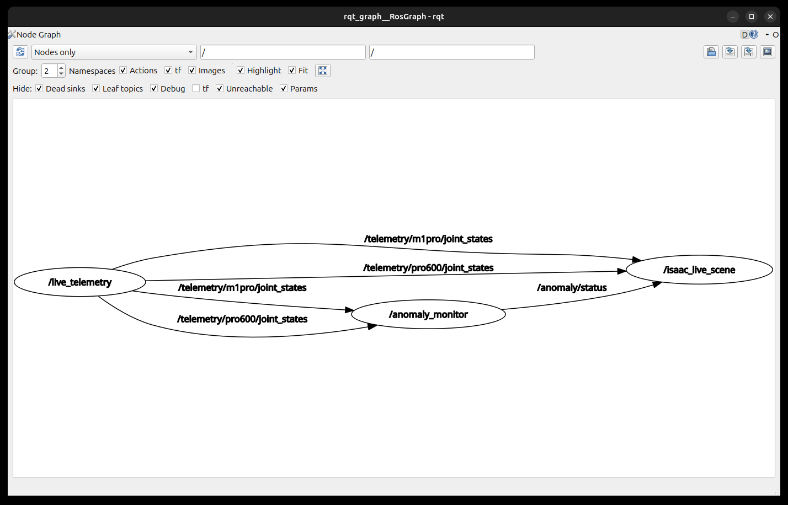

> **Before you start:** Read the [introduction, safety rules and network setup](/labs/lab-00-digital-twin/). The appendices this lab refers to are on the same page.

**Code repository:** [JatinSatyam26/wafer-cell-digital-twin](https://github.com/JatinSatyam26/wafer-cell-digital-twin) (commit `75990ed`)  
**Printable manual:** [Lab 1 (PDF)](/assets/Projects/Wafer-Cell-Digital-Twin/pdf/Lab1_ReadOnlyBridge.pdf)  
**Course data:** [course_materials.zip](https://github.com/JatinSatyam26/wafer-cell-digital-twin-labs/releases/download/v1.0/course_materials.zip) (unzip into your home folder as `~/course_materials/`)

## Lab Objective

In this lab you bring the joint angles of both robots into ROS 2 (Robot Operating System 2) without sending a single command to a robot or to the programmable logic controller (PLC). You first run the bridge on your desk against recorded robot data. Then you prove from the source code that it has no write path, run it on the real cell, and read the PLC state once over Modbus. You will reproduce the headline result: both robots published live at 50.0 Hz, with no bad M1 Pro frames.

## 1.1 About the Read-Only Bridge

A digital twin is only as good as the data that reaches it. The twin laptop reads each robot through a channel that cannot move it (Table 1.1). The Pro 600 broadcast comes from the cell's Pro 600 bridge on the cell laptop, not from the robot itself (the cell's original PLC program and bridge scripts; see Acknowledgments).

*Table 1.1: The two live robot feeds read by the twin*
| Robot | Channel | Format | Source rate |
|---|---|---|---|
| Dobot M1 Pro (192.168.10.40) | TCP client on feedback port 30004 | 1440-byte binary frames | about 123 Hz, continuous |
| myCobot Pro 600 (via the cell laptop, 192.168.10.5) | UDP broadcast, port 5005 | JSON: `device`, `label`, 6 `angles` in degrees | about 15–20 Hz while moving; silent between jobs |

One node, `live_telemetry`, publishes the newest sample of each robot every 0.02 s (50 Hz) as a `sensor_msgs/JointState` message with the twin's joint names, in radians and metres. The M1 Pro arrives faster than 50 Hz and the Pro 600 slower, so the bridge works as a *sample-and-hold*: between two Pro 600 packets, subscribers receive the last known angles again. Gazebo, Isaac Sim and the anomaly monitor in Labs 2–6 all subscribe to these topics.

The PLC keeps its state in Modbus registers. The most useful one is `Step_Mirror` (holding register 400031, protocol address 30), a copy of the sequencer step (Appendix B). The running twin never opens a connection to the PLC and never writes to it. It sees PLC state in three read-only ways:

- **A one-shot snapshot**, `archive/tools/plc_snapshot.py`, which you run once in Section 1.7.
- **A simulated step** from the Gazebo sequencer, which publishes `/cell/plc_step` with the same step numbers as `Step_Mirror` (used in Lab 4).
- **The cell logger CSV**, written by `Run_logger.py` on the cell laptop during a real run and used after the run in Labs 5 and 6.

## 1.2 What You Need

*Table 1.2: Equipment and software*
| Item | Version or value |
|---|---|
| Twin laptop | Ubuntu 24.04.5 LTS, kernel 7.0.0-42-generic |
| ROS 2 | Jazzy (`ros-jazzy-desktop` 0.11.0, `rclpy` 7.1.12), including `rqt_graph` |
| Python | 3.12.3; `pymodbus` 3.6.9 in `~/venvs/wafer_shadow` (PLC snapshot only) |
| Twin code | `~/wafer-cell-digital-twin`, branch `main`, commit `75990ed` |
| Network | Wired port at 192.168.10.60/24, no gateway; firewall allows UDP 5005 from 192.168.10.0/24 |

All commands run from the repository folder `~/wafer-cell-digital-twin`. The desk test replays two recordings from the cell that are stored in the repository under `data/recordings_2026-09-11/`. Appendix A (register map) is used in Section 1.7.

> **Warning:** The twin is read-only. You may connect to M1 Pro port 30004, listen on UDP port 5005 and make Modbus **reads**. Never connect to Pro 600 port 5001 or M1 Pro ports 29999 and 30003, and never write a Modbus register or coil: on this cell a register write is a robot command. Never use the `--pro600-direct` option of `live_telemetry.py`; it takes the Pro 600's only client slot. Only the instructor starts a cell cycle or changes the laptop firewall.

## 1.3 Read the Bridge Code

Before running the bridge, read how it decodes the M1 Pro. Each 1440-byte frame holds the joints (`QActual`: J1, J2 in degrees, J3 in mm, J4 in degrees) at byte 432 and the tool vector at byte 624. On a SCARA (Selective Compliance Assembly Robot Arm) robot the tool angle R equals J1 + J2 + J4, so the bridge uses R as an integrity check.

1. Open `tools/live/live_telemetry.py`. Line 33 sets the frame size and the two offsets: `PACKET, OFF_Q, OFF_TOOL = 1440, 432, 624`.
2. Read the M1 Pro reader thread:

```python
def m1_thread(src, ip, port, stop):
    while not stop.is_set():
        try:
            sock = socket.create_connection((ip, port), timeout=5); sock.settimeout(3.0); src.connected = True
            print(f'[m1pro] connected to {ip}:{port} (read-only)', flush=True)
            while not stop.is_set():
                buf = b''
                while len(buf) < PACKET:
                    chunk = sock.recv(PACKET - len(buf))
                    if not chunk: raise ConnectionError('feedback port closed')
                    buf += chunk
                q = struct.unpack_from('<6d', buf, OFF_Q); r = struct.unpack_from('<6d', buf, OFF_TOOL)[3]
                if abs((q[0] + q[1] + q[3]) - r) > 0.01:
                    src.bad += 1; continue                       # torn frame or moved offsets
                src.push(m1_map(q[0], q[1], q[2], q[3]))
        except Exception as e:                                   # noqa: BLE001
            src.connected = False; print(f'[m1pro] {e}; reconnecting in 2 s', flush=True); stop.wait(2.0)
```

3. Note three design choices. The socket is only read (`recv`), never written. The loop never sleeps, because a paused reader lets frames queue up and the simulated arm then jumps between old positions. A frame that fails the check by more than 0.01 is dropped and counted as `bad`.
4. Read `udp_thread` in the same file. It binds to `0.0.0.0` (all interfaces), because a socket bound to the laptop's own address can miss broadcasts. It ignores packets from other devices.
5. Read `m1_map` and `p6_map` in `tools/live/replay_telemetry.py`. They convert vendor angles to the twin's joints (Table 1.3).

*Table 1.3: Joint mappings used by the bridge*
| Robot | Twin joint | Value published |
|---|---|---|
| M1 Pro | `m1pro_z_lift` (m) | (J3 + 24.4 mm) / 1000 |
| M1 Pro | `m1pro_shoulder` | J1 |
| M1 Pro | `m1pro_elbow` | −J2 + 1.961° |
| M1 Pro | `m1pro_wrist` | J4 − 17.54° |
| Pro 600 | `pro600_joint1` … `pro600_joint6` | Vendor angle; joints 2 and 4 add 90° |

## 1.4 Desk Test with Robot Stand-ins

`tools/live/fake_robots.py` replays the recordings in each robot's own wire format: a TCP server on port 30004 and JSON packets to UDP port 5005 on your own machine.

> **Warning:** Run the desk test with the laptop unplugged from the cell switch, and keep `--udp-host 127.0.0.1`. Fake packets sent to the cell network would mix with the real ones.

1. Open three terminals. In each one, run:

```bash
cd ~/wafer-cell-digital-twin && source /opt/ros/jazzy/setup.bash
export ROS_AUTOMATIC_DISCOVERY_RANGE=LOCALHOST ROS_DOMAIN_ID=77
```

2. In Terminal 1, start the stand-ins:

```bash
python3 tools/live/fake_robots.py --m1 data/recordings_2026-09-11/m1_feedback_20260911_144727.md --pro600 data/recordings_2026-09-11/pro600_sequence_20260911.md --udp-host 127.0.0.1
```

Expected output:

```text
[fake m1] serving 1440-byte frames on 30004
[fake pro600] sending JSON to 127.0.0.1:5005
```

3. In Terminal 2, start the bridge against the stand-ins. The option `--no-park` skips a Gazebo call that matters only when Gazebo runs.

```bash
python3 tools/live/live_telemetry.py --m1-ip 127.0.0.1 --m1-port 30004 --udp-port 5005 --no-park
```

Expected: two start-up lines, then one status line per second:

```text
[pro600] listening on UDP 5005
[m1pro] connected to 127.0.0.1:30004 (read-only)
m1pro: LIVE 123.0 Hz age 2 ms frames 246 bad 0 | pro600: LIVE  17.5 Hz age 201 ms frames 35 bad 0
```

4. Watch for about one minute. The M1 Pro stays near 123 Hz. The Pro 600 rate varies during the replay, then settles at 20.0 Hz when the stand-in holds the last pose. `bad` stays at 0.

5. In Terminal 3, list the topics. Expect seven, including:

```bash
ros2 topic list -t --no-daemon
```

```text
/telemetry/health [std_msgs/msg/String]
/telemetry/m1pro/joint_states [sensor_msgs/msg/JointState]
/telemetry/pro600/joint_states [sensor_msgs/msg/JointState]
```

The two `/<robot>_position_controller/commands` topics carry the same values for the simulated arms in Gazebo. No robot listens to ROS 2.

6. Measure the rates. Stop each command with Ctrl+C after about 10 s.

```bash
ros2 topic hz /telemetry/m1pro/joint_states
ros2 topic hz /telemetry/pro600/joint_states
ros2 topic hz /telemetry/health
```

Expected: both joint-state topics average 50.0 Hz and the health topic 1.000 Hz. A first `WARNING: ... does not appear to be published yet` line is harmless.

7. Read one message per robot with `ros2 topic echo --once --no-daemon /telemetry/m1pro/joint_states` and the same for `/telemetry/pro600/joint_states`. The M1 Pro message names `m1pro_z_lift`, `m1pro_shoulder`, `m1pro_elbow` and `m1pro_wrist`; the Pro 600 message names `pro600_joint1` to `pro600_joint6`.

> **Tip:** Check: seven topics are listed, both joint-state topics run at 50.0 Hz, and `bad` is 0 for both robots.

## 1.5 HOME Gate and Read-Only Proof

`tools/live/home_check.py` compares the first message of each arm with HOME from the twin's model and prints `PASS` when the worst joint is within 2° (2 mm for the lift). It only subscribes.

1. Wait until the Pro 600 status in Terminal 2 holds at 20.0 Hz. The stand-ins then hold the recorded HOME pose.
2. In Terminal 3, run the gate:

```bash
source /opt/ros/jazzy/setup.bash && source install/setup.bash && tools/live/home_check.py
```

Expected, among the joint lines:

```text
      -> HOME CHECK m1pro: worst 0.10  PASS
      -> HOME CHECK pro600: worst 0.27  PASS
```

3. Stop the gate with Ctrl+C.

Now prove that the bridge cannot write.

4. Search the live tools for any word a write path would use:

```bash
cd ~/wafer-cell-digital-twin && grep -nEi "write|send|command|connect|set_angles|movj|enable" tools/live/*.py tools/live/*.sh
```

5. Sort the 26 lines you get into the groups of Table 1.4.

*Table 1.4: What the broad search finds*
| Hits | Writes to hardware? | Why |
|---|---|---|
| `fake_robots.py`: `sendall`, `sendto` | No | The stand-ins sending fake data on localhost |
| `live_telemetry.py`: `connected`, `create_connection` | No | A status flag, and the TCP client on port 30004, which only calls `recv` |
| `.../position_controller/commands`, docstrings, `bench_check.sh` hint | No | Simulated-arm topics and printed text |
| `live_telemetry.py`: `ElephantRobot(...).start_client()` | Opens port 5001 | The `--pro600-direct` fallback; off unless given; never used in this course |

6. Run the narrow search for Modbus writes and the forbidden ports:

```bash
grep -nE "write_register|write_coil|ModbusTcpClient|pymodbus|29999|30003|5001" tools/live/*.py tools/live/*.sh
```

Expected: two lines, `live_telemetry.py:132` and `live_telemetry.py:138`, both part of the `--pro600-direct` option. There is no Modbus client and no port 29999 or 30003 anywhere in the live tools.

7. Stop the bridge and the stand-ins with Ctrl+C in Terminals 2 and 1. Check that nothing is left running with `ps -eo pid,args | grep -E "fake_robots|live_telemetry"`.

> **Tip:** Check: both arms PASS the HOME gate, and you can explain both lines of the narrow search. In its default mode the bridge has no path that writes to a robot or to the PLC.

## 1.6 Run the Bridge on the Live Cell

1. Close the desk terminals. Plug the laptop's wired port into the cell switch.
2. Open three new terminals. In each one, run the line below. Do not set the desk-test `export` line here.

```bash
cd ~/wafer-cell-digital-twin && source /opt/ros/jazzy/setup.bash
```

3. In Terminal 1, run the pre-flight check. It pings the M1 Pro, the Pro 600, the cell laptop and the PLC, then listens for 5 s on UDP 5005.

```bash
tools/live/bench_check.sh
```

Expected first and last lines:

```text
[ok]   wired link up at 192.168.10.60
PRE-FLIGHT OK
```

4. Start the bridge with its default addresses (M1 Pro 192.168.10.40:30004, UDP 5005):

```bash
source /opt/ros/jazzy/setup.bash && python3 tools/live/live_telemetry.py --no-park
```

Expected while the cell is idle: the M1 Pro is `LIVE`, and the Pro 600 shows `no data` because its bridge has not run a job yet.

```text
[m1pro] connected to 192.168.10.40:30004 (read-only)
m1pro: LIVE 122.5 Hz age 7 ms frames 366 bad 0 | pro600: no data   0.0 Hz age - ms frames 0 bad 0
```

5. In Terminal 2, start the HOME gate before anything moves:

```bash
source /opt/ros/jazzy/setup.bash && source install/setup.bash && tools/live/home_check.py
```

The M1 Pro verdict appears at once; the Pro 600 verdict appears with the first packet of its first job.

> **Warning:** The instructor now starts one cell cycle from the cell's own controls. Stand clear of both robots and the conveyor. The instructor keeps the E-stop within reach until the cycle ends. Your laptop only watches.

6. Watch Terminal 1. When the Pro 600 moves, its status turns `LIVE` at about 15–20 Hz. Between jobs it shows `IDLE (last N s ago)`. This pause is normal.
7. In Terminal 3, while the cycle runs, repeat the two `ros2 topic hz` and the two `ros2 topic echo --once --no-daemon` commands of Section 1.4 and save the output as text. Expect 50.0 Hz on both joint-state topics.

> **Tip:** Check: the M1 Pro is `LIVE` with `bad 0`, the Pro 600 went `LIVE` while it moved, and both joint-state topics run at 50.0 Hz on the real cell.

## 1.7 Read the PLC Once

The snapshot tool reads seven holding registers and two coils once over Modbus TCP port 502, prints them and exits. It wraps the Modbus client in a class that offers only the two read functions, so the program has no write call:

```python
class ReadOnly:
    """Exposes read_holding_registers / read_coils and nothing else."""
    def __init__(self, client):
        self._c = client

    def read_holding_registers(self, addr):
        return self._c.read_holding_registers(addr, count=1)

    def read_coils(self, addr):
        return self._c.read_coils(addr, count=1)
```

1. With the cell idle after the cycle, run the snapshot with the virtual environment that provides `pymodbus`:

```bash
~/venvs/wafer_shadow/bin/python archive/tools/plc_snapshot.py
```

2. Compare your output with the expected snapshot of the real PLC with the cell idle (laser lines omitted):

```text
[ok]   Modbus TCP 192.168.10.10:502 (read-only snapshot)
  holding  0 (400001)  Pro 600 Cmd_Word           = 0
  holding  1 (400002)  Pro 600 Status_Word        = 0  [idle]
  holding 10 (400011)  M1 Pro Cmd_Word_2          = 0
  holding 11 (400012)  M1 Pro Status_Word_2       = 0  [idle]
  holding 30 (400031)  Step_Mirror                = 0
  coil     0 (000001)  Vac_On  (-> _IO_EM_DO_02)  = False
  coil     1 (000002)  Vac_Blow (-> _IO_EM_DO_01) = False
```

3. Interpret each line with Appendix A. All command words are 0 (no job requested), all status words are 0 (idle), `Step_Mirror` is 0 (step 0, idle), and the vacuum is off.

> **Note:** The snapshot is a one-off check. During a run, PLC state reaches the twin through the simulated `/cell/plc_step` in Gazebo (Lab 4) and through the cell logger CSV after the run (Labs 5 and 6).

## 1.8 See the Whole Data Flow

1. The instructor starts the full twin stack (bridge, anomaly monitor, Isaac Sim scene and camera viewer):

```bash
tools/bench/demo_record.sh ready
```

2. Open the graph viewer with `rqt_graph`. Select *Nodes only*, and press the refresh button at the top left if only one node appears.
3. Compare your graph with Figure 1.1. `/live_telemetry` is the only source of robot data, and no arrow points into it.


*Figure 1.1: rqt_graph on the twin laptop at the cell during a normal cycle. /live_telemetry publishes both joint-state topics to /isaac_live_scene and /anomaly_monitor; /anomaly_monitor publishes /anomaly/status to /isaac_live_scene.*

4. Close `rqt_graph`. The instructor stops the stack. Stop your bridge and HOME gate with Ctrl+C.

## 1.9 Results

Table 1.5 gives the expected results for the desk test and for a run at the cell.

*Table 1.5: Expected results*
| Measurement | Desk test | Live cell |
|---|---|---|
| Topics listed | 7 | 7 |
| Joint-state topic rate (M1 Pro / Pro 600) | 50.0 / 50.0 Hz | 50.0 / 50.0 Hz |
| `/telemetry/health` rate | 1.000 Hz | — |
| M1 Pro source rate | 122.0–123.0 Hz | 122.5–123.0 Hz |
| Pro 600 source rate | 9.5–20 Hz, then 20 Hz | about 15–20 Hz while moving |
| `bad` frames | 0 in about 60 s | 0 |
| HOME gate, worst joint | M1 0.10°, Pro 600 0.27°, both PASS | — |
| Narrow `grep` search | 2 lines, both `--pro600-direct` | — |
| PLC snapshot | — | All words 0, `Step_Mirror` 0, coils False |
| `rqt_graph` | — | 3 nodes, as in Figure 1.1 |

In a longer run at the cell, the bridge counted 1 bad M1 Pro frame out of 417 645 in about 57 minutes. The integrity check caught it, so the twin never received it.

*Table 1.6: Your results*
| Measurement | Desk test | Live cell |
|---|---|---|
| Topics listed | | |
| Joint-state topic rate (M1 Pro / Pro 600) | | |
| M1 Pro source rate | | |
| `bad` frames after about 1 minute | | |
| HOME gate, worst joint and verdict | | |
| `Step_Mirror` in the PLC snapshot | — | |

## 1.10 Troubleshooting

*Table 1.7: Troubleshooting*
| Problem | Likely cause | Fix |
|---|---|---|
| `pro600: no data` while the M1 Pro is `LIVE` | The firewall drops UDP 5005, or the Pro 600 bridge is idle | The instructor runs `sudo ufw allow from 192.168.10.0/24 to any port 5005 proto udp`; then wait for a Pro 600 job |
| Topics invisible in another terminal | Different `ROS_DOMAIN_ID` or discovery range, or a stale daemon | Use the same setup lines in every terminal; run `ros2 daemon stop` |
| `ros2: command not found` or `package not found` | A `source` line was skipped | Source `/opt/ros/jazzy/setup.bash`, and also `install/setup.bash` for `home_check.py` |
| The `bad` count keeps rising | Torn frames, or offsets 432/624 no longer match the firmware | Check the offsets against the controller's feedback format |
| `bench_check.sh` fails its first line with the cable plugged in | The wired port is not named `eno1` | Confirm 192.168.10.60/24 with `ip -br addr` |

## 1.11 Check Your Understanding

1. Why may the twin connect to M1 Pro port 30004, but never to Pro 600 port 5001?
2. An M1 Pro frame gives J1 = −30.004°, J2 = 75.101° and J4 = 62.443°. What R must the tool vector carry for the bridge to accept the frame?
3. The M1 Pro reports J3 = 157.12 mm. Compute `m1pro_z_lift` and compare it with the first position in your M1 Pro `echo` output.
4. Sketch a node that publishes `Step_Mirror` (protocol address 30) as `/cell/plc_step`. How would you keep it read-only, and how would you prove that with `grep`?

## 1.12 Files Used in This Lab

*Table 1.8: Files used in this lab*
| File | Purpose |
|---|---|
| [`tools/live/live_telemetry.py`](https://github.com/JatinSatyam26/wafer-cell-digital-twin/blob/75990ed/tools/live/live_telemetry.py) | The read-only bridge |
| [`tools/live/fake_robots.py`](https://github.com/JatinSatyam26/wafer-cell-digital-twin/blob/75990ed/tools/live/fake_robots.py) | Desk stand-ins for both robots |
| [`tools/live/replay_telemetry.py`](https://github.com/JatinSatyam26/wafer-cell-digital-twin/blob/75990ed/tools/live/replay_telemetry.py) | Joint mappings imported by the bridge |
| [`tools/live/home_check.py`](https://github.com/JatinSatyam26/wafer-cell-digital-twin/blob/75990ed/tools/live/home_check.py) | The HOME gate |
| [`tools/live/bench_check.sh`](https://github.com/JatinSatyam26/wafer-cell-digital-twin/blob/75990ed/tools/live/bench_check.sh) | Network pre-flight check |
| [`archive/tools/plc_snapshot.py`](https://github.com/JatinSatyam26/wafer-cell-digital-twin/blob/75990ed/archive/tools/plc_snapshot.py) | One-shot read-only PLC snapshot |
| [`src/wafer_cell_bringup/scripts/cell_sequencer.py`](https://github.com/JatinSatyam26/wafer-cell-digital-twin/blob/75990ed/src/wafer_cell_bringup/scripts/cell_sequencer.py) | Gazebo sequencer that publishes the simulated `/cell/plc_step` |
| [`tools/bench/demo_record.sh`](https://github.com/JatinSatyam26/wafer-cell-digital-twin/blob/75990ed/tools/bench/demo_record.sh) | Starts the full twin stack for Section 1.8 |
| [`data/recordings_2026-09-11/`](https://github.com/JatinSatyam26/wafer-cell-digital-twin/tree/75990ed/data/recordings_2026-09-11) | Robot recordings replayed in the desk test |

Credits: see Acknowledgments.
