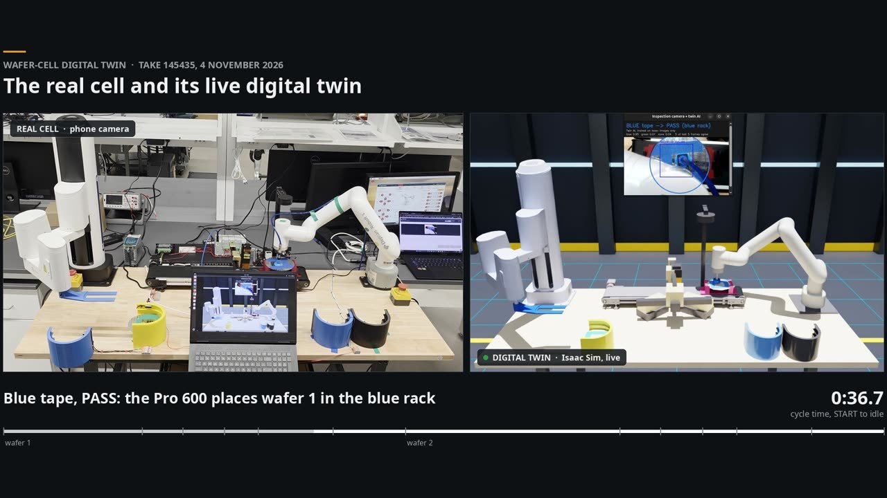
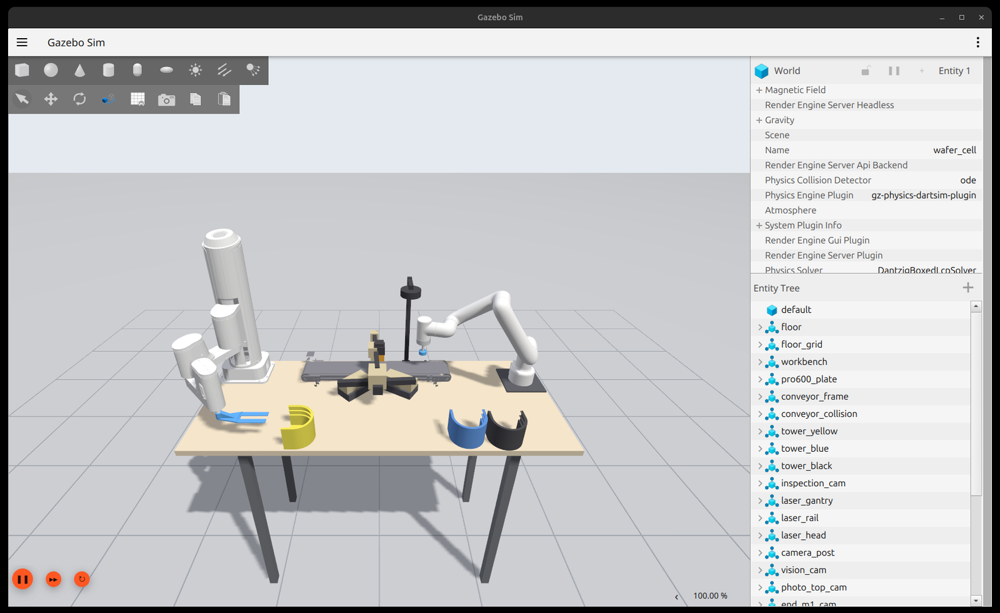
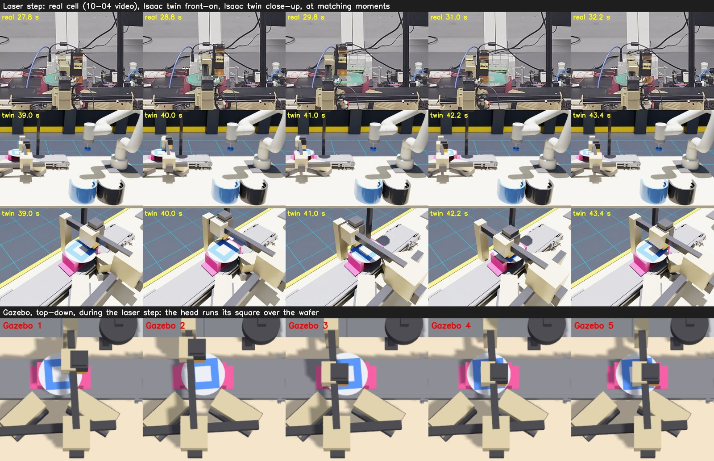
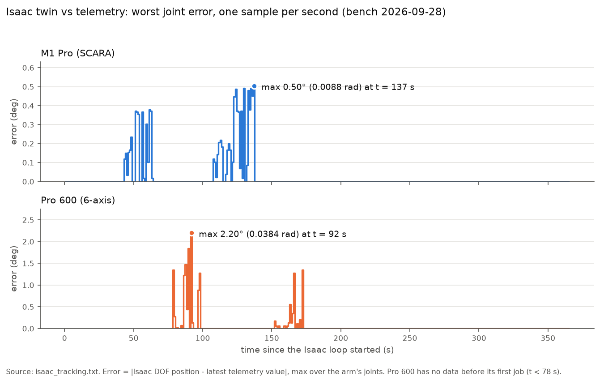

> **Before you start:** Read the [introduction, safety rules and network setup](/labs/lab-00-digital-twin/). The appendices this lab refers to are on the same page.

**Code repository:** [JatinSatyam26/wafer-cell-digital-twin](https://github.com/JatinSatyam26/wafer-cell-digital-twin) (commit `75990ed`)  
**Printable manual:** [Lab 2 (PDF)](/assets/Projects/Wafer-Cell-Digital-Twin/pdf/Lab2_LiveTwin.pdf)  
**Course data:** [course_materials.zip](https://github.com/JatinSatyam26/wafer-cell-digital-twin-labs/releases/download/v1.0/course_materials.zip) (unzip into your home folder as `~/course_materials/`)

## Lab Objective

In this lab you turn the two joint-state topics from Lab 1 into a moving three-dimensional model of the cell. You build the cell's scene in NVIDIA Isaac Sim 6.1, rehearse it on your desk with a recorded real cycle, and then watch it mirror both robots live while the cell runs. You also run the same telemetry through the Gazebo Harmonic version of the twin. Finally, you measure how closely the twin follows the data. The expected result is a largest sampled gap of 0.50° on the M1 Pro and 2.20° on the Pro 600, on a cycle recorded at the cell.

## 2.1 About the Live Digital Twin

The live twin is a kinematic mirror. The real robots report their joint angles, and the simulated robots take the same angles. Nothing in the twin pushes back on the cell. In the Isaac scene gravity is off, and every simulated joint holds its position with a stiff drive. The bench, conveyor and racks are static props placed at the poses of the real cell.

The data path is the one you built in Lab 1. The M1 Pro's feedback frames arrive on TCP (Transmission Control Protocol) port 30004. The Pro 600's joint angles arrive as a UDP (User Datagram Protocol) broadcast on port 5005, sent by the cell's own Pro 600 bridge (the cell's original PLC program and bridge scripts; see Acknowledgments). The bridge `tools/live/live_telemetry.py` maps both feeds to the twin's URDF (Unified Robot Description Format) joint names and units. It publishes them at 50 Hz per arm on `/telemetry/m1pro/joint_states` and `/telemetry/pro600/joint_states`. Positions are in radians, except the M1 Pro's lift joint `m1pro_z_lift`, which is in metres.

Two simulators can consume these topics:

- **Isaac Sim** (`tools/isaac/isaac_live_scene.py`) subscribes with a plain `rclpy` node and sets each arm's joint targets by joint name. Isaac Sim 6.1 uses Python 3.12, the same version as ROS 2 Jazzy, so the script imports ROS 2 directly.
- **Gazebo** (`cell.launch.py telemetry:=true`) loads the same robot model and drives the arms with two forward position controllers.

Never run both at once on the twin laptop: it does not have the memory for both.


*Figure 2.1: The real cell (left, phone camera) and the live Isaac Sim twin (right) during the same cycle. The Pro 600 is placing wafer 1 in the blue rack. The inset at the top right of the twin is the vision window from Lab 4.*

Before anything moves, a **HOME gate** compares the first message from each arm with the twin's HOME pose. A wrong sign or offset in a joint mapping does not crash anything: the twin simply shows the arm in the wrong place. The gate catches this while both robots still stand at HOME. You met the gate and the joint mappings in Lab 1.

## 2.2 What You Need

Table 2.1: Equipment and software

| Item | Version or detail |
|---|---|
| Twin laptop | Ubuntu 24.04.5 LTS; NVIDIA GeForce RTX 4060 Laptop GPU, driver 595.99.02 |
| ROS 2 | Jazzy (`ros-jazzy-desktop` 0.11.0) |
| Gazebo | Gazebo Sim 8.15.0 (Harmonic), `ros-jazzy-gz-ros2-control` 1.2.20 |
| Isaac Sim | 6.1.0.0, installed with pip in `~/venvs/isaacsim` (Python 3.12.3); installation in Appendix D |
| Twin code | `~/wafer-cell-digital-twin`, branch `main`, commit `75990ed`, built with `colcon build --symlink-install` |
| Cell (Section 2.5 only) | M1 Pro 192.168.10.40, Pro 600 192.168.10.20, cell laptop 192.168.10.5; twin laptop wired at 192.168.10.60 |

Every ROS 2 terminal in this lab starts with the same three lines. Without the last one, ROS 2 reports "package not found".

```bash
cd ~/wafer-cell-digital-twin
source /opt/ros/jazzy/setup.bash
source install/setup.bash
```

> **Note:** The robot models come from the vendors. The M1 Pro description is from Dobot's `m1pro_description` package (MIT License, Copyright (c) 2022 Dobot). The Pro 600 description is from Elephant Robotics' `mycobot_ros2` (declared BSD upstream). Both were corrected on import; see the `ATTRIBUTION.md` file in each description package and the repository's `NOTICE`.

> **Warning:** The twin only reads. Never connect to the Pro 600 on TCP port 5001 or to the M1 Pro on ports 29999 or 30003, and never use the bridge option `--pro600-direct`. In Section 2.5 the instructor starts the cell cycle, with the cell clear and the E-stop in reach. Students stay outside both robots' working areas for the whole session.

## 2.3 Build the Isaac Scene

Isaac Sim works with USD (Universal Scene Description) files, not URDF. The build takes the generated model `src/wafer_cell_bringup/urdf/cell_telemetry.urdf` and runs four steps:

1. `make_isaac_urdf.py` writes `tools/isaac/cell_isaac.urdf`. It turns the 13 `package://` mesh links into absolute paths and removes the Gazebo-only `<ros2_control>` and `<gazebo>` blocks.
2. `urdf_usd_converter` converts that file to `tools/isaac/usd/wafer_cell.usdc`: ten movable joints with the URDF names.
3. `make_props_json.py` reads the props from the Gazebo world `worlds/wafer_cell.sdf`.
4. `make_props_usd.py` writes those props to `tools/isaac/usd/props.usdc`.

The folder `tools/isaac/usd/` is not stored in git. Build it once after every fresh clone, and again after any change to the robot model.

1. Check that the GPU is visible. The command must list the RTX 4060.

```bash
nvidia-smi
```

2. Run the build (one line):

```bash
cd ~/wafer-cell-digital-twin
tools/isaac/make_isaac_urdf.py && ~/venvs/isaacsim/bin/python -m urdf_usd_converter --no-layer-structure tools/isaac/cell_isaac.urdf tools/isaac/usd && tools/isaac/make_props_json.py && ~/venvs/isaacsim/bin/python tools/isaac/make_props_usd.py
```

   The first line of output comes from `make_isaac_urdf.py`:

```text
wrote .../cell_isaac.urdf: 13 mesh paths made absolute; ros2_control and gazebo blocks removed
```

> **Tip:** Check: `tools/isaac/usd/wafer_cell.usdc` and `tools/isaac/usd/props.usdc` both exist.

The converter adds no joint drives. When the scene starts, `isaac_live_scene.py` gives every movable joint a stiff position drive:

```python
STIFF, DAMP = 1.0e5, 1.0e3
movable = []
for p in stage.Traverse():
    if p.IsA(UsdPhysics.Joint) and not p.IsA(UsdPhysics.FixedJoint) and str(p.GetPath()).startswith('/World/cell'):
        kind = 'linear' if p.IsA(UsdPhysics.PrismaticJoint) else 'angular'
        d = UsdPhysics.DriveAPI.Apply(p, kind)
        d.CreateTypeAttr('force'); d.CreateStiffnessAttr(STIFF); d.CreateDampingAttr(DAMP); d.CreateMaxForceAttr(1.0e6)
        movable.append(p.GetName())
```

The script also switches off self-collision on each robot and disables the robots' collision shapes. A mirror needs no contact. With the converter's default settings, the Pro 600's neighbouring links push against each other until the arm becomes unstable.

## 2.4 Rehearse on Your Desk

This part needs no robots. You feed Isaac Sim with a real cycle recorded at the cell, through the replay tool.
 The replay tool publishes the same topics as the live bridge.

1. In terminal 1, start Isaac Sim. The script activates `~/venvs/isaacsim` and sources ROS 2 itself.

```bash
cd ~/wafer-cell-digital-twin
tools/isaac/run_isaac_live.sh
```

   A window opens within about a minute. The terminal prints `drives on 10 joints`, `both arms set to HOME`, `scene ready`, and then one status line per second, for example:

```text
[isaac_live] t=  1.0s  m1pro: 89 msgs, worst err 0.0000 | pro600: no data
```

2. In terminal 2, start the replay:

```bash
cd ~/wafer-cell-digital-twin
source /opt/ros/jazzy/setup.bash && source install/setup.bash && tools/live/replay_telemetry.py --m1 data/recordings_2026-09-11/m1_feedback_20260911_144727.md --pro600 data/recordings_2026-09-11/pro600_sequence_20260911.md --loop --no-park
```

   Both Isaac arms start to move. On each status line the message counts rise by about 50 per second.

3. To get the front view, open the viewport's camera menu (top left, reads *Perspective*) and choose Cameras → `check_cam`. Alt + left-drag orbits, Alt + middle-drag pans, and the scroll wheel zooms.

4. Stop the replay with Ctrl+C in terminal 2. Then stop Isaac with Ctrl+C in terminal 1. Shutdown takes 1–3 minutes.

> **Tip:** Check: both arms stand at HOME before the motion starts and follow the recorded cycle.

> **Note:** Closing the Isaac window ends Isaac Sim. Never run the replay while the live bridge runs: both publish on the same topics.

**How the arms follow the data.** The scene's ROS 2 callback stores the latest message of each arm as a dictionary of joint name → position. The main loop then sets the joint targets **by name**, never by index. On each arm's first message it also places the arm directly at that pose:

```python
        for r, q in snap.items():
            if not q: continue
            art = arts[r]; idx = [dof_index(art, n) for n in q]; vals = [q[n] for n in q]
            if first[r] or a.mode == 'teleport':
                art.set_dof_positions(vals, dof_indices=idx)
                art.set_dof_velocities([0.0] * len(idx), dof_indices=idx)
                first[r] = False
            if a.mode == 'targets':
                art.set_dof_position_targets(vals, dof_indices=idx)
```

Both arms start at HOME, read from the `initial_value` parameters in `cell_telemetry.urdf`. The Pro 600 therefore waits at HOME until its first job sends data.

## 2.5 Mirror the Live Cell in Isaac Sim

This part runs on the twin laptop, connected to the cell switch, while the cell runs one normal cycle. All four terminals only read from the cell. Start them in this order.

1. In terminal 1, run the pre-flight check:

```bash
cd ~/wafer-cell-digital-twin
tools/live/bench_check.sh
```

   It checks the wired link at 192.168.10.60 and pings each device. It ends with `PRE-FLIGHT OK`. Silence on the Pro 600 broadcast is normal until the Pro 600 runs a job.

2. In terminal 1, start the read-only bridge:

```bash
source /opt/ros/jazzy/setup.bash && source install/setup.bash && tools/live/live_telemetry.py --no-park
```

   Within seconds it prints `m1pro: LIVE ~122 Hz ... bad 0` once per second. The Pro 600 shows `no data` until its first job, `LIVE` during a job and `IDLE` between jobs.

3. In terminal 2, start Isaac Sim with `tools/isaac/run_isaac_live.sh`, as in Section 2.4, and switch the viewport to `check_cam`.

4. In terminal 3, run the HOME gate:

```bash
cd ~/wafer-cell-digital-twin
source /opt/ros/jazzy/setup.bash && source install/setup.bash && tools/live/home_check.py
```

   For each arm's first message, the gate prints each joint's difference from HOME. It then prints a line `-> HOME CHECK m1pro: worst … PASS`. `PASS` means the worst joint is within 2° (or 2 mm for the lift joint). The M1 Pro is checked at once. The Pro 600 is checked when its first job starts.

> **Warning:** If any arm shows `NOT AT HOME`, tell the instructor. The cycle does not start until the M1 Pro passes.

5. In terminal 4, record the run:

```bash
source /opt/ros/jazzy/setup.bash && ros2 bag record -o ~/bench_$(date +%F)/bag_$(date +%H%M%S) --topics /telemetry/m1pro/joint_states /telemetry/pro600/joint_states /telemetry/health
```

   Wait until the terminal shows `Recording...`. The time of day is in the folder name because `ros2 bag record -o` refuses a folder that already exists.

> **Warning:** The instructor now starts the cell's bridges and one cycle, with the cell clear and the E-stop in reach. Students watch from outside both robots' working areas and do not touch the cell.

6. Watch the twin. The M1 Pro moves first, then the Pro 600, in the cell's own sequence. When the Pro 600's first job starts, check its HOME gate line in terminal 3.


*Figure 2.2: The Isaac Sim twin following the cell live during a normal cycle at the cell (front view). The M1 Pro is carrying wafer 1 from the yellow rack to the carrier; the Pro 600 waits at HOME for its first job. This run also used the options `--wafers` (wafers shown) and `--anomaly` (the cell monitor panel at the lower left, from Lab 5).*

7. After the cycle, copy the `[isaac_live]` lines from terminal 2 into a text file. You use it in Section 2.7.

8. Stop in this order: the recorder (terminal 4), the HOME gate (terminal 3), the bridge (terminal 1), then Isaac Sim (terminal 2). Use Ctrl+C every time. A recording that is killed any other way cannot be read.

> **Tip:** Check: both arms passed the HOME gate, the twin followed both arms through the cycle, and both arms ended at HOME.

## 2.6 Run the Gazebo Twin

The Gazebo twin uses the same bridge and the same topics. With `telemetry:=true`, `cell.launch.py` loads `cell_telemetry.urdf` and starts `m1pro_position_controller` and `pro600_position_controller` (forward position controllers defined in `cell_controllers.yaml`). In this mode it spawns no wafer. Here you run it on your desk. `tools/live/fake_robots.py` replays the recorded real cycle in the robots' own network formats on your laptop, so the real bridge runs unchanged.

1. In terminal 1, start Gazebo in telemetry mode:

```bash
cd ~/wafer-cell-digital-twin
source /opt/ros/jazzy/setup.bash && source install/setup.bash && ros2 launch wafer_cell_bringup cell.launch.py gui:=true cameras:=false telemetry:=true
```

   The Gazebo window opens and both arms hold HOME.

2. In terminal 2, start the robot stand-ins:

```bash
cd ~/wafer-cell-digital-twin
tools/live/fake_robots.py --m1 data/recordings_2026-09-11/m1_feedback_20260911_144727.md --pro600 data/recordings_2026-09-11/pro600_sequence_20260911.md --loop
```

3. In terminal 3, start the bridge against the stand-ins:

```bash
cd ~/wafer-cell-digital-twin
source /opt/ros/jazzy/setup.bash && source install/setup.bash
tools/live/live_telemetry.py --m1-ip 127.0.0.1
```

   The bridge shows `m1pro: LIVE`, and both Gazebo arms start to follow the recording.


*Figure 2.3: The Gazebo twin in telemetry mode on a desk, driven by the read-only bridge from a replay of the recorded real cycle. The Pro 600 reaches towards the carrier while the M1 Pro is swung out to the side.*

4. Stop terminals 2 and 3 with Ctrl+C. Then stop Gazebo with the stop script. Ctrl+C on `ros2 launch` alone can leave the Gazebo server running in the background.

```bash
cd ~/wafer-cell-digital-twin && tools/gazebo/stop_sim.sh
```

> **Tip:** Check: both Gazebo arms started at HOME and followed the replayed cycle.

At the cell, Gazebo follows the run-book `docs/reference/shadow_bringup/REAL_TO_SIM_RUNBOOK.md`. The order is `bench_check.sh`, then the launch command above, then `tools/live/live_telemetry.py` without `--no-park`. With both robots at HOME, the Gazebo arms must sit at HOME before the instructor runs a cycle.

### The laser step in both twins

The laser engraver has no network connection, so the twin cannot read its position. Instead, both twins replay the same motion the cell's laser bridge sends: a 70 mm square of rapid G-code moves (`G0`) that starts and ends at the resting corner. The beam never fires. The square starts when the carrier reaches the laser stop (PLC step 4).

The head's resting place was measured from a 4K video of the real cell. The wafer (127 mm across) and the belt's 207.3 mm travel from the laser stop to the pick point served as rulers, giving a scale of 2.05 pixels per millimetre. At rest the real head sits 51 mm from the wafer centre toward the Pro 600, and the far side of its square reaches 18 mm past the centre toward the M1 Pro, both within ±5 mm. The twin uses these measurements: in `src/wafer_cell_bringup/scripts/cell_layout.py`, `LASER_PARK_X` (+0.050 m) is the resting place and `LASER_MOVES` is the square. Isaac Sim (`tools/isaac/live_wafers.py`) and Gazebo (`src/wafer_cell_bringup/scripts/laser_head_motion.py`) both read them from that file.

1. Open `src/wafer_cell_bringup/scripts/cell_layout.py` and find `LASER_PARK_X`, `LASER_SIDE` and `LASER_MOVES`. Each entry in `LASER_MOVES` is one side of the square: its start time and duration in seconds, the axis, and the distance in metres.
2. Compare the four moves with the G-code square of the cell's laser bridge: park, then four 70 mm sides, then back to the park corner.
3. Study Figure 2.4. Check that the head in both twins runs its square over the wafer, as it does in the real cell.


*Figure 2.4: The laser step in the real cell (top row, from a video of the cell), in the Isaac twin (front view and close-up) and in Gazebo (top-down, bottom row), at matching moments. In all three the head runs its 70 mm square over the wafer.*

On a recorded cycle, the Isaac twin's square started within 0.1 s of the PLC's laser step, with the carrier at the laser stop.

## 2.7 Measure the Tracking Error

Once per second, the Isaac scene prints a "worst err" value for each arm:

```python
        now = time.time()
        if now - last >= 1.0:
            last = now; parts = []
            for r, art in arts.items():
                q = snap[r]
                if q:
                    cur = art.get_dof_positions().numpy().reshape(-1) if hasattr(art.get_dof_positions(), 'numpy') else list(art.get_dof_positions())
                    err = max(abs(float(cur[dof_index(art, n)]) - v) for n, v in q.items())
                    parts.append(f'{r}: {counts[r]} msgs, worst err {err:.4f}')
```

This code defines what the lab's headline number means:

- `q` is the latest telemetry message for the arm: the robot's own encoder readings, mapped to URDF joints.
- `cur` holds the positions of the simulated joints in Isaac.
- `err` is the largest absolute difference over the arm's joints, in the joints' own units: radians, plus metres for the M1 Pro's lift joint.
- It is **one instantaneous sample per second**, not the maximum over that second.

The tracking error is therefore **the largest gap between the Isaac joints and the live telemetry, sampled once per second**. It shows the twin following the data. It is not a comparison between the twin and the real arm measured by an independent sensor. It includes about one physics step of lag. It does not include network or bridge delay, and it says nothing about how well the model's geometry matches the real robot.

1. Open your text file of `[isaac_live]` lines from Section 2.5 (or from Section 2.4 if you only rehearsed).
2. For each arm, find the largest `worst err` value. Ignore lines where the arm shows `no data`.
3. Note the time `t` of that line.
4. Convert the value to degrees: degrees = radians × 180 / π.
5. Count the lines with data and the lines with a non-zero error for each arm.

> **Tip:** Check: you can state your result in one sentence: "The largest once-per-second gap between the Isaac joints and the telemetry was … rad (… °) on the M1 Pro and … rad (… °) on the Pro 600."

## 2.8 Results

Table 2.2: Expected results, Isaac Sim twin, first recording at the cell

| Quantity | M1 Pro | Pro 600 |
|---|---|---|
| Largest once-per-second gap between Isaac joints and telemetry | 0.0088 rad = **0.50°** (t = 137.2 s) | 0.0384 rad = **2.20°** (t = 91.8 s) |
| RMS (root mean square) of all samples | 0.10° | 0.27° |
| Samples with data | 358 | 282 |
| Samples with a non-zero error | 42 | 30 |

The error is zero in most samples. It rises only while an arm moves fast. The Pro 600 has no samples before its first job. The run's recording lasts 461.0 s and holds 33,580 messages.


*Figure 2.5: Tracking log of the first recording at the cell. Each step is one once-per-second sample of the largest gap between the Isaac joints and the telemetry: M1 Pro (top), Pro 600 (bottom).*

A second recording at the cell used the same statistic with `--wafers` and `--anomaly` switched on. It gave 0.0141 rad = 0.81° (M1 Pro, 462 lines) and 0.0437 rad = 2.50° (Pro 600, 251 lines). Over the two recordings, the largest sampled gap was 0.5–0.8° on the M1 Pro and 2.2–2.5° on the Pro 600.

Table 2.3: Your results

| Quantity | M1 Pro | Pro 600 |
|---|---|---|
| Run date and source (replay or live) | | |
| Lines with data | | |
| Lines with a non-zero error | | |
| Largest `worst err` (rad) | | |
| Largest `worst err` (°) and its time `t` (s) | | |
| HOME gate result (PASS / NOT AT HOME) | | |

## 2.9 Troubleshooting

Table 2.4: Troubleshooting

| Problem | Likely cause | Fix |
|---|---|---|
| `pro600: no data` while the M1 Pro works | The firewall drops UDP 5005, or the Pro 600 is not running a job | Ask the instructor to check the firewall rule (chapter "Network and Data Feeds"); silence between jobs is normal |
| `ros2: command not found` or "package not found" | Only one source line was run | Run the three lines in Section 2.2 |
| Black Isaac window, or `scene ready` without the GPU | Kernel updated without its NVIDIA module | Run `nvidia-smi`; ask the instructor to reinstall the driver module (Appendix D) |
| Isaac stops at start-up with an error naming `wafer_cell.usdc` | Scene assets not built after a clone | Run the build in Section 2.3 |
| The next Gazebo launch fails with `Controller already loaded` | An old `gz sim` process survived | Run [`tools/gazebo/stop_sim.sh`](https://github.com/JatinSatyam26/wafer-cell-digital-twin/blob/75990ed/tools/gazebo/stop_sim.sh) |

## 2.10 Check Your Understanding

1. Which two ROS 2 topics does the twin subscribe to, and in which units does each joint arrive?
2. Why is the headline number (0.50° / 2.20°) a measure of the twin following the data, and not of the twin matching the real arm?
3. The M1 Pro's `worst err` mixes radians and metres, and it keeps one instantaneous sample per second. Suggest a better statistic, and explain how to log it without slowing the Isaac loop.
4. What does the HOME gate protect against? What would you see in the twin if the +90° offset of the Pro 600's joint 2 were left out of the mapping?

## 2.11 Files Used in This Lab

Table 2.5: Files used in this lab

| File | Purpose |
|---|---|
| [`tools/isaac/isaac_live_scene.py`](https://github.com/JatinSatyam26/wafer-cell-digital-twin/blob/75990ed/tools/isaac/isaac_live_scene.py) | The live Isaac Sim twin: drives, subscriber, tracking line |
| [`tools/isaac/run_isaac_live.sh`](https://github.com/JatinSatyam26/wafer-cell-digital-twin/blob/75990ed/tools/isaac/run_isaac_live.sh) | Starts the scene with the Isaac environment and ROS 2 |
| [`tools/isaac/make_isaac_urdf.py`](https://github.com/JatinSatyam26/wafer-cell-digital-twin/blob/75990ed/tools/isaac/make_isaac_urdf.py), `make_props_json.py`, `make_props_usd.py` | Build the Isaac scene assets |
| [`tools/live/live_telemetry.py`](https://github.com/JatinSatyam26/wafer-cell-digital-twin/blob/75990ed/tools/live/live_telemetry.py) | The read-only bridge (Lab 1) |
| [`tools/live/replay_telemetry.py`](https://github.com/JatinSatyam26/wafer-cell-digital-twin/blob/75990ed/tools/live/replay_telemetry.py) | Joint mappings and the desk replay |
| [`tools/live/home_check.py`](https://github.com/JatinSatyam26/wafer-cell-digital-twin/blob/75990ed/tools/live/home_check.py), [`tools/live/fake_robots.py`](https://github.com/JatinSatyam26/wafer-cell-digital-twin/blob/75990ed/tools/live/fake_robots.py), [`tools/live/bench_check.sh`](https://github.com/JatinSatyam26/wafer-cell-digital-twin/blob/75990ed/tools/live/bench_check.sh) | The HOME gate; desk robot stand-ins; pre-flight check at the cell |
| [`src/wafer_cell_bringup/scripts/cell_layout.py`](https://github.com/JatinSatyam26/wafer-cell-digital-twin/blob/75990ed/src/wafer_cell_bringup/scripts/cell_layout.py), [`tools/isaac/live_wafers.py`](https://github.com/JatinSatyam26/wafer-cell-digital-twin/blob/75990ed/tools/isaac/live_wafers.py), [`src/wafer_cell_bringup/scripts/laser_head_motion.py`](https://github.com/JatinSatyam26/wafer-cell-digital-twin/blob/75990ed/src/wafer_cell_bringup/scripts/laser_head_motion.py) | The cell layout and the laser's resting place and square; the laser motion in Isaac Sim and in Gazebo |
| [`src/wafer_cell_bringup/launch/cell.launch.py`](https://github.com/JatinSatyam26/wafer-cell-digital-twin/blob/75990ed/src/wafer_cell_bringup/launch/cell.launch.py), `config/cell_controllers.yaml` | The Gazebo twin and its controllers |
| [`docs/results/isaac_live_twin/ISAAC_BENCH_RUNBOOK.md`](https://github.com/JatinSatyam26/wafer-cell-digital-twin/blob/75990ed/docs/results/isaac_live_twin/ISAAC_BENCH_RUNBOOK.md) | Isaac run-book for the cell |
| [`NOTICE`](https://github.com/JatinSatyam26/wafer-cell-digital-twin/blob/75990ed/NOTICE) | Licences of the robot models and other third-party files |

Credits: see Acknowledgments.
