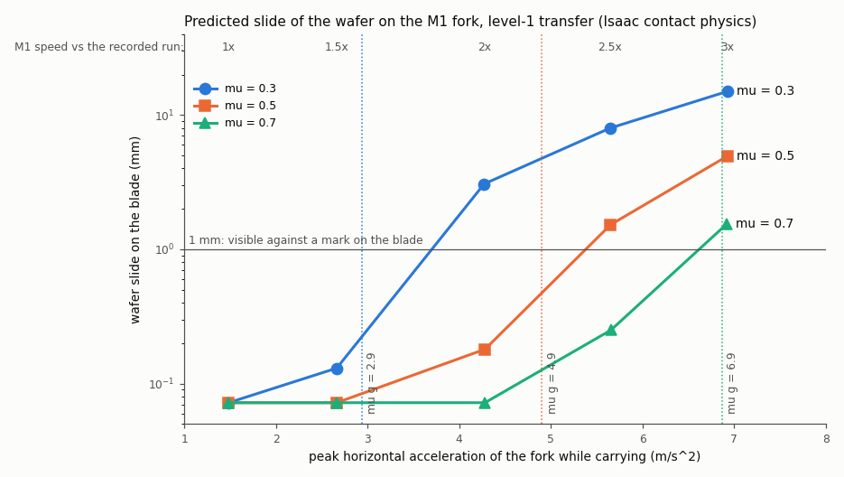

> **Before you start:** Read the [introduction, safety rules and network setup](/labs/lab-00-digital-twin/). The appendices this lab refers to are on the same page.

**Code repository:** [JatinSatyam26/wafer-cell-digital-twin](https://github.com/JatinSatyam26/wafer-cell-digital-twin) (commit `75990ed`)  
**Printable manual:** [Lab 3 (PDF)](/assets/Projects/Wafer-Cell-Digital-Twin/pdf/Lab3_ContactPhysics.pdf)  
**Course data:** [course_materials.zip](https://github.com/JatinSatyam26/wafer-cell-digital-twin-labs/releases/download/v1.0/course_materials.zip) (unzip into your home folder as `~/course_materials/`)

## Lab Objective

In this lab you replay recorded cycles of the cell in NVIDIA Isaac Sim with real contact physics: no welds, so the wafers are held only by gravity, contact and friction. You judge every wafer with a strict pass/fail check. You then measure how far a wafer slid on the M1's fork in a bench test at higher robot speed, and you compare that with the physics prediction for several friction coefficients. The headline result you reproduce: 2.6 mm predicted at μ 0.3; the bench measured 2.1 mm (twice) and 2.5 mm with the second wafer.

## 3.1 About Contact Physics

In Lab 2 the twin's wafers followed the arms because the software placed them there. Such a "weld" can never slide, fall or land off-centre, so it cannot tell you what happens when a robot moves faster. In this lab each wafer is a rigid cylinder, 63.5 mm in radius and 2 mm thick, moved by the PhysX physics engine. The Dobot M1 Pro's fork lifts a wafer because the blade is under it. The carrier holds it because it sits in the seat. A rack takes it because it lands on a shelf. The myCobot Pro 600's vacuum cup is a compliant "bellows" joint that is created when the vacuum turns on and removed when it turns off.

The inputs are only what a real run recorded: both arms' joint streams, the belt targets and the vacuum coil state from the PLC (programmable logic controller) log. The physics engine decides everything else.

**Why the wafer slides.** A wafer on a level blade is carried by static friction alone. Coulomb's law says it starts to slide when the blade's horizontal acceleration exceeds μ·*g*. For μ = 0.3 this is 0.3 × 9.81 m/s² ≈ 2.9 m/s².

Before any bench test, the model was asked how far the wafer slides if the recorded top-shelf transfer is played *k* times faster. Playing a trajectory *k* times faster multiplies its accelerations by *k*². At μ 0.3 the slide was 0.07, 0.13, 3.07, 7.99 and 15.0 mm for *k* = 1, 1.5, 2, 2.5 and 3. The peak fork accelerations were 1.48, 2.66, 4.27, 5.65 and 6.93 m/s². The jump comes where the peak acceleration passes μ·*g*, as Coulomb friction predicts (Figure 3.1).


*Figure 3.1: Predicted slide of the wafer on the M1 fork for the time-scaled top-shelf transfer, for μ 0.3, 0.5 and 0.7, against the peak horizontal fork acceleration (logarithmic scale). The dotted lines mark μ·g for each μ.*

**How a result is judged.** A seated wafer has only 0.5 mm of radial play, so it is either flat on its seat or perched on the rim. The strict verdict therefore passes a wafer only if it is in the right place (where the real wafer went), flat (within 0.2 mm of the seat height, tilt ≤ 0.2°), centred (≤ 3 mm from the modelled centre) and settled (flat within 1.0 s of its last fast motion, and never off again).

## 3.2 What You Need

*Table 3.1: Equipment and software*
| Item | Version or detail |
|---|---|
| Twin workstation | Ubuntu 24.04.5 LTS, NVIDIA GeForce RTX 4060 Laptop GPU, driver 595.99.02 |
| ROS 2 | Jazzy |
| Isaac Sim | 6.1.0.0 in the virtual environment `~/venvs/isaacsim` (Python 3.12.3), run headless |
| Offline analysis | system Python 3.12.3 with NumPy 1.26.4, OpenCV 4.6.0 and SciPy 1.11.4 |
| Twin code | `~/wafer-cell-digital-twin`, branch `main`, commit `75990ed`, already built (Appendix D) |
| Bench recordings | `~/course_materials/lab3_contact_physics/bench_2026-10-26/`, one folder per run, each with `bag/` and `webcam/` |

You also need Lab 2 (the Isaac scene and the joint mappings) and basic Coulomb friction.

> **Warning:** Never run the Gazebo twin and Isaac Sim at the same time. Together they exceed the workstation's memory and graphics memory.

> **Warning:** The physics replays are offline and touch no robot. The bench slip test (Section 3.5) raises a robot's speed with glass wafers on board. Only the instructor runs it. Students never connect to the Pro 600 port 5001 or the M1 ports 29999 and 30003.

## 3.3 Replay a Recorded Cycle in Physics

You replay Run 1, a recorded two-wafer cycle. In that run the top-shelf wafer went to the black rack and the bottom-shelf wafer to the blue rack.

**Why the arms are driven, not placed.** PhysX computes contact forces from motion. If a joint is set straight to each recorded angle (teleported), the blade jumps and the solver throws the wafer off. A stiff drive makes the blade vibrate, so the wafer creeps along it. The replay uses a soft proportional–derivative (PD) drive and feeds the recorded joint velocity forward:

```python
        art.set_dof_position_targets(q, dof_indices=idx[arm])
        if not a.no_ff:                                    # velocity feed-forward: the damping term tracks the stream's speed
            art.set_dof_velocity_targets(arm_qd(arm, t).tolist(), dof_indices=idx[arm])
```

The friction coefficient is one material bound to every contact pair, set by `--mu` (default 0.5):

```python
pm.CreateStaticFrictionAttr(a.mu); pm.CreateDynamicFrictionAttr(0.9 * a.mu); pm.CreateRestitutionAttr(0.0)
```

*Table 3.2: Main settings of the physics replay*
| Setting | Value |
|---|---|
| Physics step, solver | 240 Hz, TGS (temporal Gauss–Seidel), continuous collision detection on |
| Friction, restitution | static μ = `--mu`, dynamic 0.9 μ; restitution 0 |
| Wafer | 16 solver position iterations, sleep threshold 0 (never asleep); mass 55.1 g (green tape) or 53.6 g (blue tape) |
| Arm drives | PD stiffness 2.0e4, damping 2.0e3, plus velocity feed-forward |
| Fork (M1) | collision box 189.5 × 58.2 × 3 mm; wafer seat 147 mm ahead of the fork frame |
| Bellows (Pro 600 cup) | sideways ±10 mm at 500 N/m, tilt ±5°, axial −4 to +6 mm at 2000 N/m, grips within 6 mm, breaks at 40 N |
| M1 drop | fork 7 mm lower at the yellow rack than at the carrier, blade level |

1. Close any running Gazebo session.
2. Check that the graphics driver is loaded. The output must list the RTX 4060 Laptop GPU.

```bash
nvidia-smi
```

3. Go to the twin repository:

```bash
cd ~/wafer-cell-digital-twin
```

4. Build the replay schedule from the recorded bags and the cell log:

```bash
source /opt/ros/jazzy/setup.bash && source install/setup.bash && python3 tools/isaac/physics/make_replay_schedule.py --run run1 --out ~/wafer_physics/run1.npz
```

5. Run the headless replay and save rendered frames. `run.sh` activates the Isaac Sim environment and sources ROS 2.

```bash
tools/isaac/physics/run.sh physics_replay.py --schedule ~/wafer_physics/run1.npz --out ~/wafer_physics/run1 --frames ~/wafer_physics/run1/frames
```

6. Judge the run with the strict verdict:

```bash
python3 tools/isaac/physics/verdict.py ~/wafer_physics/run1
```

Expected output:

```text
   wafer1: black (real: black), 0.8 mm off centre, 0.0 mm above the seat, tilt 0.03 deg, flat on the seat 0.05 s after its last fast motion -> PASS
   wafer2: blue (real: blue), 0.1 mm off centre, 0.0 mm above the seat, tilt 0.04 deg, flat on the seat 0.15 s after its last fast motion -> PASS
```

7. Open `~/wafer_physics/run1/frames` and follow both wafers through the cycle. Compare them with Figure 3.2.


*Figure 3.2: Eight rendered frames of the physics replay of Run 1: wafer 1 on the top shelf, lifted by the fork, in the carrier, on the cup and placed in the black rack; then wafer 2 picked from the bottom shelf, in the carrier and placed in the blue rack. Rendered from an earlier version of the model with the same recorded arm motion.*

> **Tip:** Check: both wafers PASS, each in the rack the real wafer went to.

Several inputs are chosen values rather than measurements: μ, the belt ramp, the cup's force limit and the M1 drop. In the recorded tests the full replay still passed with μ 0.3 and 0.7, wafer masses of 40 g and 90 g, a 2.0 m/s² belt ramp, a 20 N cup limit and an M1 drop of 5.5, 12 or 17.9 mm. At normal speed, none of the tested values changed the outcome.

## 3.4 Predict the Slide

This section reproduces Figure 3.1: the run-1 top-shelf transfer played at *k* = 1 to 3 for μ 0.3, 0.5 and 0.7.

1. From `~/wafer-cell-digital-twin`, run the sweep:

```bash
python3 tools/isaac/physics/slip_sweep.py --schedule ~/wafer_physics/run1.npz --out ~/wafer_physics/slip
```

2. Open `~/wafer_physics/slip/slip_vs_speed.png` and compare it with Figure 3.1.
3. For μ 0.3, note the peak fork acceleration at which the slide first exceeds 1 mm. You will compare it with the bench accelerations in Section 3.6.

## 3.5 The Bench Slip Test (Instructor Demonstration)

The recorded slip test at the cell works as follows. The instructor raised only the M1's `SpeedFactor`, from 20 (the normal cycle) to 40, 50 and 60, and pressed START for a normal two-wafer cycle each time (the cell's original PLC program and bridge scripts; see Acknowledgments).

> **Warning:** The instructor performs every step of this section, with the cell clear and the E-stop in reach. The M1 bridge sends `SpeedFactor` once, at start-up, so the instructor restarts the bridge after each edit. The wafers are glass: stop raising the speed as soon as a wafer visibly moves on the fork. Nobody handles a wafer while a cycle runs. Students never edit or restart a bridge script.

1. The twin workstation runs the read-only bridge from Lab 2 (`tools/live/live_telemetry.py`) and records both arms' joint topics in a bag.
2. The twin workstation records the inspection webcam at 5 frames per second with `tools/bench/record_mjpeg.py`. It polls `/snapshot.jpg` from the cell laptop's webcam server on port 8080.
3. The instructor sets `SpeedFactor`, restarts the M1 bridge and presses START.

**How the shift is seen.** If the wafer slides on the fork, the fork sets it down off-centre in the carrier. The carrier then moves the wafer to the pick stop, where the inspection camera looks almost straight down on it. Comparing the wafer's position there with its position in the normal-speed run gives the shift.

## 3.6 Measure the Shift from the Webcam Frames

`analyse_speed_run.py` finds each M1 trip in the bag. It computes the fork seat's position by forward kinematics from the recorded joints and smooths it with a Savitzky–Golay filter. It then takes the peak horizontal acceleration while the fork carries the wafer:

```python
                Ps = savgol_filter(Pi, 11, 3, axis=0)
                acc = np.linalg.norm(np.gradient(np.gradient(Ps[:, :2], tt, axis=0), tt, axis=0), axis=1)
                carrying = (Pi[:, 2] > 0.105)                                       # above the shelves and the carrier
```

For the wafer centre, the script fits a Hough circle to each webcam frame around the Pro 600's pick and takes the median. It converts pixels to millimetres using the wafer's own 127 mm diameter.

> **Note:** The script saves `analysis.json` inside the run folder it analyses. Work only in `~/course_materials/lab3_contact_physics/`, never on original recordings.

1. Source ROS 2 in a new terminal, then go to the repository:

```bash
source /opt/ros/jazzy/setup.bash
cd ~/wafer-cell-digital-twin
```

2. Analyse the `SpeedFactor` 60 run against the normal-speed run:

```bash
python3 tools/bench/analyse_speed_run.py ~/course_materials/lab3_contact_physics/bench_2026-10-26/speed60 ~/course_materials/lab3_contact_physics/bench_2026-10-26/speed20
```

The script prints one line per M1 trip and one line per wafer. For trip 1 (the top shelf), the expected values are a 9.3 s trip with a peak fork acceleration of 3.93 m/s² (baseline: 20.7 s, 1.78 m/s²). For wafer 1, the shift against the baseline is −0.2 / −2.1 mm (image x / y), 2.1 mm in total.

3. Repeat step 2 for the run folders `speed40`, `speed40b`, `speed50_was40`, `speed50`, `speed60_aborted2` and `speed60_swapped`. Always use `speed20` as the baseline.
4. Enter the trip-1 results of each run in Table 3.4.

> **Tip:** Check: your `speed60` top-shelf shift is 2.1 mm, mostly along the image y axis. The peak accelerations at `SpeedFactor` 40–60 are higher than the μ·*g* = 2.9 m/s² of Section 3.1.

## 3.7 Replay the Bench Trips in Physics

Now replay the M1's recorded top-shelf trip from each bench run with one wafer, at the blue-tape wafer's mass, for μ 0.3, 0.35, 0.4 and 0.5.

1. From `~/wafer-cell-digital-twin`, cut the `speed60` top-shelf trip into a replay schedule (12.3 s long):

```bash
source /opt/ros/jazzy/setup.bash && python3 tools/bench/make_trip_schedule.py ~/course_materials/lab3_contact_physics/bench_2026-10-26/speed60 ~/wafer_physics/slipbench/speed60.npz
```

2. Replay it at μ 0.3:

```bash
tools/isaac/physics/run.sh physics_replay.py --schedule ~/wafer_physics/slipbench/speed60.npz --out ~/wafer_physics/slipbench/mu0.3_speed60 --wafers wafer1 --mu 0.3 --wafer-mass 0.0536 --log-hz 60
```

Expected (last lines of `events.txt`):

```text
END wafer1: carrier (the real one: carrier), 2.6 mm from its centre, +1.11 mm above the seat, tilt 1.00 deg -> NOT SEATED, FAIL
STRICT wafer1: carrier (real: carrier), 2.6 mm off centre, 1.11 mm above the seat, tilt 1.0 deg, flat on the seat never after its last fast motion -> FAIL (flat, settled)
done: 12.3 s of the run in 34 s wall
```

This FAIL is the effect you are looking for. The wafer slid on the fork and was set down on the carrier's rim instead of in the seat.

3. Repeat step 2 with `--mu 0.35`, `--mu 0.4` and `--mu 0.5`. Change the `--out` folder to match each value, for example `mu0.35_speed60`. At μ 0.35 the wafer ends seated, 0.5 mm from the centre, and passes.
4. Repeat steps 1–3 for the runs `speed20`, `speed40b` and `speed50`.
5. For each run and μ, compute the predicted shift: the distance between the wafer's final XY position (`pos` in `verdict.json`) and its final XY position in the `speed20` replay at the same μ.

Worked example at μ 0.3: the `speed60` replay ends at (−262.5, 162.0) mm and the `speed20` replay at (−265.0, 161.3) mm. The difference is (+2.5, +0.7) mm, so the predicted shift is 2.6 mm.

> **Tip:** Check: at `SpeedFactor` 60, μ 0.3 predicts 2.6 mm; μ 0.35, 0.4 and 0.5 predict 0.2, 0.3 and 0.1 mm.

## 3.8 Results

*Table 3.3: Expected results of the slip test (top-shelf trip, shift against the `speed20` run)*
| SpeedFactor | Run folder | Trip (s) | Peak fork acc. (m/s²) | Measured shift (mm) | Predicted μ 0.3 / 0.35 / 0.4 / 0.5 (mm) |
|---|---|---|---|---|---|
| 20 | speed20 | 20.7 | 1.78 | 0 (baseline) | 0 (baseline) |
| 40 | speed40 | 12.2 | 2.65 | 1.7 | — |
| 40 | speed40b | 12.2 | 3.23 | 0.8 | 0.3 / 0.1 / 0.0 / 0.0 |
| 40 | speed50_was40 | 12.2 | 2.64 | 0.9 | — |
| 50 | speed50 | 10.5 | 3.30 | 1.0 | 0.3 / 0.3 / 0.2 / 0.0 |
| 60 | speed60 | 9.3 | 3.93 | 2.1 | **2.6** / 0.2 / 0.3 / 0.1 |
| 60 | speed60_aborted2 | 9.3 | 3.88 | 2.1 | — |
| 60, wafers swapped | speed60_swapped | 9.3 | 4.30 | 2.5 (second wafer) | — |

**Headline:** 2.6 mm predicted at μ 0.3; the bench measured 2.1 mm (twice) and 2.5 mm with the second wafer.

How to read these numbers:

- The two 2.1 mm values come from two separate `SpeedFactor` 60 runs with the blue-tape wafer on the top-shelf trip. In the 2.5 mm run the wafers were swapped, so the green-tape wafer made that trip. It is compared with a baseline that carried the blue-tape wafer. That run also had the highest peak acceleration, 4.30 m/s².
- μ 0.3 is the lowest value tried that reproduces the jump at `SpeedFactor` 60. Of the four values replayed, only 0.3 gives a shift of about 2 mm; 0.35 gives 0.2 mm. The bench test does not measure μ itself. It shows which model value reproduces the jump.
- The **size** of the jump agrees. The **direction** and the **growth pattern** differ. The replay shift is +2.5 mm along the belt and +0.7 mm across it. The bench shift lies mostly along the image y axis and grows gradually with speed (0.8 → 1.0 → 2.1 mm for `speed40b`, `speed50` and `speed60`). The replay shows a threshold instead.
- Single runs scatter. The three `SpeedFactor` 40 runs gave 0.8, 0.9 and 1.7 mm. Within one run, the wafer centre spread by 0.8–2.1 mm across the 9–10 frames used for the median.

*Table 3.4: Your results (top-shelf trip)*
| SpeedFactor | Run folder | Trip (s) | Peak fork acc. (m/s²) | Measured shift (mm) | Predicted μ 0.3 / 0.35 / 0.4 / 0.5 (mm) |
|---|---|---|---|---|---|
| 20 | speed20 | | | 0 (baseline) | 0 (baseline) |
| 40 | speed40 | | | | |
| 40 | speed40b | | | | |
| 40 | speed50_was40 | | | | |
| 50 | speed50 | | | | |
| 60 | speed60 | | | | |
| 60 | speed60_aborted2 | | | | |
| 60, wafers swapped | speed60_swapped | | | | |

Record your run-1 verdict too: rack, off-centre distance, height above the seat, tilt and PASS/FAIL for each wafer.

## 3.9 Troubleshooting

*Table 3.5: Troubleshooting*
| Problem | Likely cause | Fix |
|---|---|---|
| Isaac Sim logs `[Error]` lines at start-up although it reports "scene ready" | the NVIDIA kernel module is not loaded (this has happened after kernel updates) | run `nvidia-smi`; if it fails, ask the instructor to install the NVIDIA module for the running kernel (Appendix D) |
| `package not found` when a command starts | only `/opt/ros/jazzy/setup.bash` was sourced | also run `source install/setup.bash` in `~/wafer-cell-digital-twin` |
| The workstation runs out of memory | Gazebo and Isaac Sim are running together | close Gazebo before any physics replay |
| The wafer creeps on the blade or is flung away | the replay was started with `--no-ff` or `--drive teleport` | use the default drive (soft PD with velocity feed-forward) |
| A bench run folder gains an `analysis.json` file | `analyse_speed_run.py` writes it into the run folder | expected; analyse only the copies in `~/course_materials/lab3_contact_physics/` |

## 3.10 Check Your Understanding

1. With μ = 0.3, at what horizontal fork acceleration should the wafer start to slide? The `speed40b` trip peaked at 3.23 m/s², yet its μ 0.3 replay shows only 0.3 mm. Suggest why. Consider how long the peak lasts and how it was smoothed.
2. The three `SpeedFactor` 40 runs gave 0.8, 0.9 and 1.7 mm. What does this spread say about how much one run can tell you? Propose a better baseline than a single normal-speed run.
3. The 2.5 mm value compares the green-tape wafer at `SpeedFactor` 60 with the blue-tape wafer at `SpeedFactor` 20. Is that a fair comparison? Design runs that separate the effect of the wafer from the effect of speed.
4. The bench shift is measured in image pixels, the replay shift in world XY coordinates. What do you need to know to compare their directions?

## 3.11 Files Used in This Lab

*Table 3.6: Files used in this lab*
| File | Purpose |
|---|---|
| [`tools/isaac/physics/physics_replay.py`](https://github.com/JatinSatyam26/wafer-cell-digital-twin/blob/75990ed/tools/isaac/physics/physics_replay.py) | headless Isaac Sim replay with contact physics: friction, colliders, PD drives with feed-forward, vacuum bellows joint |
| [`tools/isaac/physics/verdict.py`](https://github.com/JatinSatyam26/wafer-cell-digital-twin/blob/75990ed/tools/isaac/physics/verdict.py) | the strict verdict (right place, flat, centred, settled) |
| [`tools/isaac/physics/make_replay_schedule.py`](https://github.com/JatinSatyam26/wafer-cell-digital-twin/blob/75990ed/tools/isaac/physics/make_replay_schedule.py) | builds a full-cycle replay schedule from recorded bags and the cell log |
| [`tools/isaac/physics/run.sh`](https://github.com/JatinSatyam26/wafer-cell-digital-twin/blob/75990ed/tools/isaac/physics/run.sh) | runs a physics script in the Isaac Sim environment with ROS 2 sourced |
| [`tools/isaac/physics/slip_sweep.py`](https://github.com/JatinSatyam26/wafer-cell-digital-twin/blob/75990ed/tools/isaac/physics/slip_sweep.py) | the slip prediction for time-scaled transfers |
| [`tools/bench/analyse_speed_run.py`](https://github.com/JatinSatyam26/wafer-cell-digital-twin/blob/75990ed/tools/bench/analyse_speed_run.py) | bench analysis: trip duration, peak fork acceleration, Hough-circle wafer centre, shift |
| [`tools/bench/make_trip_schedule.py`](https://github.com/JatinSatyam26/wafer-cell-digital-twin/blob/75990ed/tools/bench/make_trip_schedule.py) | turns one recorded M1 top-shelf trip into a replay schedule |
| [`tools/bench/record_mjpeg.py`](https://github.com/JatinSatyam26/wafer-cell-digital-twin/blob/75990ed/tools/bench/record_mjpeg.py) | records webcam snapshots during the bench test |
| [`docs/results/contact_physics/README.md`](https://github.com/JatinSatyam26/wafer-cell-digital-twin/blob/75990ed/docs/results/contact_physics/README.md) | the contact model, its failures and fixes, and the slip prediction |
| [`docs/results/bench_2026-10-26/README.md`](https://github.com/JatinSatyam26/wafer-cell-digital-twin/blob/75990ed/docs/results/bench_2026-10-26/README.md) | the recorded slip test and its results table |

Credits: see Acknowledgments.
