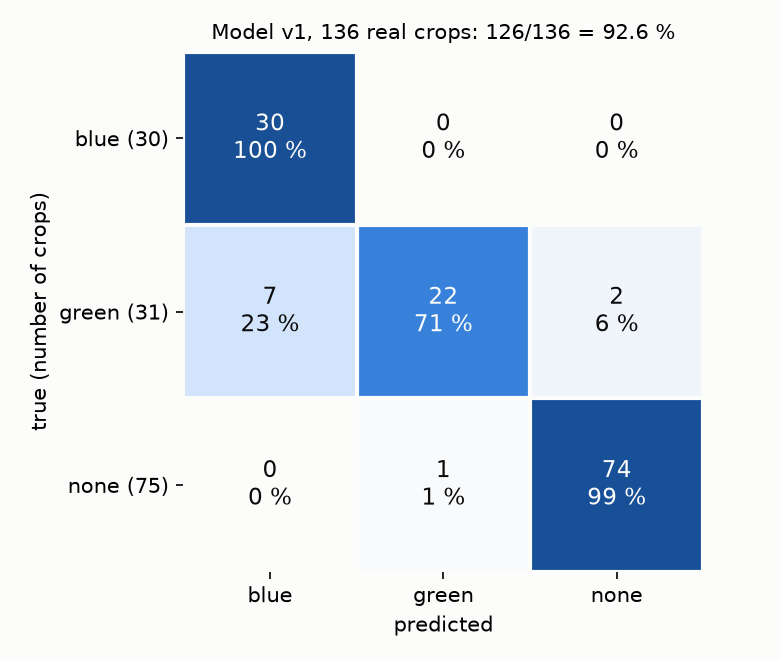
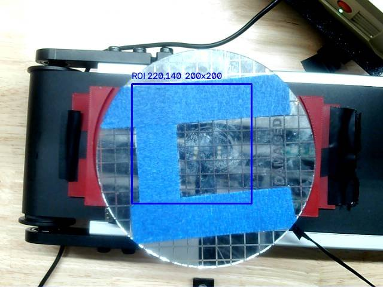
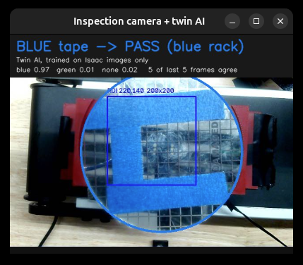

> **Before you start:** Read the [introduction, safety rules and network setup](/labs/lab-00-digital-twin/). The appendices this lab refers to are on the same page.

**Code repository:** [JatinSatyam26/wafer-cell-digital-twin](https://github.com/JatinSatyam26/wafer-cell-digital-twin) (commit `75990ed`)  
**Printable manual:** [Lab 4 (PDF)](/assets/Projects/Wafer-Cell-Digital-Twin/pdf/Lab4_SimVision.pdf)  
**Course data:** [course_materials.zip](https://github.com/JatinSatyam26/wafer-cell-digital-twin-labs/releases/download/v1.0/course_materials.zip) (unzip into your home folder as `~/course_materials/`)

## Lab Objective

In this lab you teach a neural network to judge the tape colour on a wafer using only images rendered in NVIDIA Isaac Sim. You generate a randomised synthetic dataset with Omniverse Replicator, train a ResNet-18 classifier and export it to the Open Neural Network Exchange (ONNX) format. You then test it blind on 136 real images of the cell, where the provided model scores 92.6 % (126 of 136), and compare it with the cell's own colour rule. Finally, you watch the model judge real wafers live beside the cell, without writing anything to the cell.

## 4.1 About Learning Vision from Simulation

At the pick stop, the cell's inspection camera decides the fate of each wafer. Blue tape means pass (blue rack), green tape means reject (black rack), and no tape stops the cell with fault 4. On the cell, this decision is made by `vision_bridge.py`, a fixed colour rule in hue, saturation and value (HSV). It counts blue and green pixels inside a 200 x 200 pixel region of interest (ROI) of the 640 x 480 webcam frame. In this lab you build the same three-way decision with a learned classifier.

Real labelled images of the cell are slow to collect. Rendered images are cheap, but a model trained on renders can learn the renderer instead of the task. **Domain randomisation** prevents this. Every image changes everything that does **not** decide the label: lights, camera position, wafer texture, bench texture, clutter and the robot's blue suction cup. The only cue that stays stable is the tape colour, so that is what the model learns. The tape hue itself is kept inside one band per class, and training shifts it by at most ±3 OpenCV units, because hue is the label.

A fair test needs images the model never saw and a model chosen before the test is scored. Model v1, the first model trained, was fixed before it was tested on the real images.


*Figure 4.1: Top row: synthetic training images (blue, webcam-like view; green, random low view; none, empty carrier). Bottom row: real images (the cell's webcam, model says blue 0.97; a phone crop with the cup up, model says green 0.96; a phone crop with the blue cup on a green wafer, model wrongly says blue 0.67).*

## 4.2 What You Need

Table 4.1: Software and hardware

| Item | Version or detail |
|---|---|
| Twin laptop | Ubuntu 24.04.5 LTS; NVIDIA GeForce RTX 4060 Laptop GPU, driver 595.99.02 |
| Isaac Sim and Replicator | 6.1.0.0, in the virtual environment `~/venvs/isaacsim` (Python 3.12.3); `isaacsim_replicator` 6.1.0.0 |
| PyTorch / torchvision | 2.11.0+cu130 / 0.26.0 |
| onnx / onnxruntime | 1.23.2 / onnxruntime-gpu 1.26.0, used on the CPU execution provider |
| ROS 2 | Jazzy |
| Twin repository | `~/wafer-cell-digital-twin`, branch `main`, commit `75990ed` |
| Model in use | [`tools/isaac/perception/models/tape_cls.onnx`](https://github.com/JatinSatyam26/wafer-cell-digital-twin/blob/75990ed/tools/isaac/perception/models/tape_cls.onnx) (model v1) |
| Disk space | about 0.65 GB per synthetic dataset (651 MB for `synth_v1`) |

You need Lab 2 (the Isaac Sim scene of the cell, `tools/isaac/usd/props.usdc`) and, for Section 4.8 only, the twin laptop on the cell network at 192.168.10.60 (Lab 1). Software setup is in Appendix D.

The wrapper `tools/isaac/perception/run.sh` runs each perception script with the Isaac Sim environment's Python and sources ROS 2 Jazzy. Run every command from the repository root:

```bash
cd ~/wafer-cell-digital-twin
```

> **Warning:** Never run the cell's classifier `vision_bridge.py` yourself. In normal mode it writes the vision result to the programmable logic controller (PLC), register 40, and it holds the only connection to the webcam. It belongs to the cell (the cell's original PLC program and bridge scripts; see Acknowledgments). In this lab the twin only reads the camera images over HTTP. Never connect to the Pro 600 port 5001 or the M1 ports 29999 / 30003, and never run Gazebo and Isaac Sim at the same time.

## 4.3 Read the Decision You Are Copying

The PLC sequencer clears `Vision_Result` when the carrier reaches the pick stop. It then waits in state 7 (Appendix B):

```text
7:  (* wait for inspection *)
    IF Vision_Result = 1 THEN
        Pass_Count := Pass_Count + 1;
        Step := 8;                      (* blue tape -> blue rack *)
    ELSIF Vision_Result = 2 THEN
        Reject_Count := Reject_Count + 1;
        Step := 9;                      (* green tape -> black rack *)
    ELSIF Vision_Result = 3 THEN
        Fault_Code := 4;
        Fault := TRUE;
    END_IF;
```

The cell's rule that produces this value is short:

```python
def classify(frame):
    """Returns (result, pass_px, reject_px)."""
    x, y, w, h = ROI
    roi = frame[y:y + h, x:x + w]
    if roi.size == 0:
        return 3, 0, 0
    hsv = cv2.cvtColor(roi, cv2.COLOR_BGR2HSV)

    p = int(cv2.countNonZero(mask_for(hsv, PASS_RANGES)))
    r = int(cv2.countNonZero(mask_for(hsv, REJECT_RANGES)))

    if p < MIN_PIXELS and r < MIN_PIXELS:
        return 3, p, r                  # neither - camera or disk problem
    return (1, p, r) if p > r else (2, p, r)
```

The blue (pass) band is OpenCV HSV (97, 120, 200)–(125, 255, 255) and the green (reject) band is (78, 90, 120)–(95, 255, 255). OpenCV hue runs from 0 to 179, half of the angle in degrees. `MIN_PIXELS` is 4000, or 10 % of the ROI. One inspection is the majority of 5 fresh frames. The third answer is deliberate: a dead or badly aimed camera gives a visibly invalid result instead of passing every wafer.

1. Open `~/course_materials/cell_reference/plc/sequencer.stf` and find state 7.
2. Open `~/course_materials/cell_reference/python/current/vision_bridge.py` and read `classify()` and `inspect()`. Read only; do not run it.

> **Tip:** Check: you can say what codes 1, 2 and 3 make the PLC do, and why the rule has a "no tape" answer.

## 4.4 Generate the Synthetic Dataset

`gen_tape_dataset.py` renders the cell at the pick stop in Isaac Sim (headless, 320 x 320 pixels, 4 renderer subframes per image). It randomises the tape layout (square frame, loose strips or a patch), 16 wafer textures, 8 bench textures, the carrier position (±3 mm), the lights (colour temperature 2700–7500 K), and the camera (55 % near the webcam's position, 45 % from anywhere between 12° and 88° elevation). The blue cup appears in 35 % of images. A "none" image is an untaped wafer or, in 30 % of cases, an empty carrier. The tape hue keeps one band per class, in degrees:

```python
TAPE_HUE = {'blue': (200, 235), 'green': (148, 182)}
```

These bands surround the cell's own bands (194–250° and 156–190°), and the boundary between blue and green is never sampled.

1. Render the training set (2,000 images per class):

```bash
tools/isaac/perception/run.sh gen_tape_dataset.py --out ~/wafer_perception/synth_v1/train --per-class 2000 --seed 1
```

2. Wait for the end of the run. The recorded run took 681 s:

```text
[gen] 6000/6000  681 s  (8.8 img/s)
[gen] done: 6000 images in ~/wafer_perception/synth_v1/train
```

3. Render the validation set with a different seed (recorded run: 900 images in 99 s):

```bash
tools/isaac/perception/run.sh gen_tape_dataset.py --out ~/wafer_perception/synth_v1/val --per-class 300 --seed 2
```

4. Count the images of each class, for example:

```bash
find ~/wafer_perception/synth_v1/train/blue -name '*.png' | wc -l
```

5. Open `~/wafer_perception/synth_v1/train/labels.csv`. Each row lists one image with its label and every random parameter.

> **Tip:** Check: 2000 images per class in `train` and 300 per class in `val`. In the provided training set, 3301 of 6000 images (55 %) use the webcam-like view and 2057 (34 %) show the cup.

## 4.5 Train and Export the Classifier

The classifier is ResNet-18 with ImageNet weights and a new 3-class output layer. The ImageNet normalisation is built into the network, so the exported model takes plain RGB values between 0 and 1:

```python
    def forward(self, x):
        return self.body((x - self.mean) / self.std)
```

Training runs 14 epochs with AdamW (learning rate 5e-4), batch size 64 and label smoothing 0.05. The augmentation imitates a cheap webcam or a phone: random crops, rotations, downscaling, blur, noise, JPEG compression, and changes of brightness, contrast, saturation and white balance.

1. Train on the synthetic images only:

```bash
tools/isaac/perception/run.sh train_tape_classifier.py --data ~/wafer_perception/synth_v1 --out tools/isaac/perception/models/tape_cls_v1
```

2. Watch the log. The recorded run started with `[train] 6000 train / 900 val images on cuda` and ended after 166 s:

```text
[train] epoch 14/14  loss 0.2452  synthetic val acc 0.9811  (166 s)
```

Your values will be close to these but not identical, because the augmentation draws new random numbers on each run.

3. Check that `tape_cls_v1.onnx`, `tape_cls_v1.pt` and `tape_cls_v1_train.json` are in `tools/isaac/perception/models/`.
4. Identify the provided model, which you use from here on:

```bash
sha256sum tools/isaac/perception/models/tape_cls*.onnx
```

> **Tip:** Check: the line for `tape_cls.onnx` starts with `e9948b62fd4a` (model v1). The model takes the input `image`, float32, shape (N, 3, 224, 224), and returns `logits`, shape (N, 3), in the order blue, green, none. The provided model scores 98.1 % (883 of 900) on the synthetic validation set.

## 4.6 Score the Model on Real Images

The real test set is in `docs/results/vision_ai/real_test/`: 136 JPEG crops and a `labels.csv` file. Most crops come from a 4K video of one recorded two-wafer cycle. A phone camera filmed it from a fixed position in front of the cell, at about 15° elevation. A 400 x 400 pixel crop was cut around the wafer every 0.5 s at the load stop or the pick stop. Three more crops come from still photos of wafer 1 in the yellow rack. The labels come from the cell's own outcome in that run: wafer 1 went to the black rack (green tape), wafer 2 to the blue rack (blue tape), and "none" is the empty carrier. No real image was used in training.

At run time, `tape_common.py` takes the centred square of each image, resizes it to 224 x 224 pixels and scales it to [0, 1].

1. Open `docs/results/vision_ai/real_test/labels.csv` and count the rows per label.
2. Score model v1 on the CPU:

```bash
tools/isaac/perception/run.sh eval_real.py --model tools/isaac/perception/models/tape_cls.onnx --test docs/results/vision_ai/real_test --out docs/results/vision_ai/results_v1
```

3. Read the first lines of the output. Expected:

```text
real images: 136  accuracy 0.926
confusion (rows true, cols predicted ['blue', 'green', 'none']):
[[30  0  0]
 [ 7 22  2]
 [ 0  1 74]]
  green/pick/cup     7/16   43.8%   5-frame vote 4/12
  none/load         46/47   97.9%   5-frame vote 39/39
```

The other seven groups score 100 %.

4. Copy the matrix into Table 4.4 and compute each class's recall (diagonal value divided by the row total). Compare it with Figure 4.2.


*Figure 4.2: Confusion matrix of model v1 on the 136 real crops (rows: true class; columns: predicted class). 126 of 136 = 92.6 % correct.*

5. Open `docs/results/vision_ai/results_v1_sheet.jpg`, which shows every crop; a red border marks a wrong verdict. Find the 10 errors:
   - 7 green read as blue, at 40.5–43.5 s: the Pro 600's blue bellows cup sits on the green wafer.
   - 2 green read as none, at 44.5–45 s: the cup has lifted the wafer off the carrier.
   - 1 none read as green: the empty carrier at the load stop, at 138 s.

> **Tip:** Check: 126 of 136 correct (92.6 %); recall blue 30/30, green 22/31, none 74/75. All 26 crops of the situation the PLC actually inspects (wafer in the carrier, cup up) are correct. The PLC judges in state 7, before the Pro 600 moves.

> **Note:** Neighbouring frames 0.5 s apart are similar, so 136 crops are not 136 independent tests. The 5-frame vote, which counts decisions the way the cell makes them, is the more honest summary: 85 of 93 vote windows are correct, and 81 of 81 outside the green-wafer-with-cup segment.

## 4.7 Compare with the Cell's Colour Rule

A fair comparison uses the same camera and the same frames. Ten frames from the cell's own webcam, saved during a normal cycle, are in `docs/results/bench_2026-10-26/inspection/`. Their true classes come from the PLC's vision codes in that run's cell log: wafer 1 blue, wafer 2 green.

1. Classify the ten frames with the model, without ROS:

```bash
tools/isaac/perception/run.sh tape_vision_node.py --images docs/results/bench_2026-10-26/inspection --once
```

2. Expected: each `wafer1_*` frame is `blue (1)` and each `wafer2_*` frame is `green (2)`, with a top probability between 0.94 and 0.97.
3. Apply the cell's rule from Section 4.3 by hand to the reference pixel counts in Table 4.2, and write a verdict for each frame.

Table 4.2: Pixel counts of the cell's rule inside its ROI, cell webcam, recorded cycle

| Frame | True class | Blue pixels | Green pixels |
|---|---|---|---|
| `wafer1_1793065508.479.jpg` | blue | 17948 | 0 |
| `wafer1_1793065508.679.jpg` | blue | 20435 | 0 |
| `wafer1_1793065508.880.jpg` | blue | 22048 | 0 |
| `wafer1_1793065509.082.jpg` | blue | 22739 | 0 |
| `wafer1_1793065509.283.jpg` | blue | 23707 | 0 |
| `wafer2_1793065583.078.jpg` | green | 0 | 18982 |
| `wafer2_1793065583.281.jpg` | green | 0 | 20713 |
| `wafer2_1793065583.483.jpg` | green | 0 | 22418 |
| `wafer2_1793065583.688.jpg` | green | 0 | 23128 |
| `wafer2_1793065583.892.jpg` | green | 0 | 22716 |

4. Now consider a different camera. An offline comparison applied an offline copy of the cell's rule (same thresholds, no camera or network code) to the 136 phone crops. It scored 76 of 136 (55.9 %) and answered "no tape" on 135 of them. On the phone images the tape looks paler: its median saturation was about 105 (blue) and 78 (green), below the rule's minimums of 120 and 90.

> **Tip:** Check: on these 10 frames from the cell's webcam, both the rule and the model were right on every frame. On the phone crops the rule scored 55.9 % and the model 92.6 %.

> **Note:** The phone test is not a fair test of the cell's rule, which was tuned for its own webcam and lighting. It shows that a hand-tuned rule is tied to the camera it was tuned on, while randomised training made the model tolerant of a camera it never saw. The model also has a limit: given only the cell's 200 x 200 ROI instead of the centred square, it got 8 of the 10 webcam frames right, because it was trained on views of the whole wafer.

## 4.8 Watch the Model Beside the Live Cell

The cell's classifier keeps making the real decision. The twin's live view, `tools/bench/live_tape_view.py`, requests one camera image at a time from the cell laptop, draws the model's verdict on it and serves the result only on the twin laptop (`127.0.0.1`, port 8090).

> **Warning:** The cell cycle moves both robots and the conveyor. The instructor runs it, with the cell clear and the E-stop in reach. Students stay outside the cell and do not touch the cell laptop or the PLC.

1. On the twin laptop, start the live view:

```bash
tools/isaac/perception/run.sh ../../bench/live_tape_view.py http://192.168.10.5:8080/snapshot.jpg
```

2. Open `http://localhost:8090/` in a browser on the twin laptop. Without a wafer at the pick stop, the banner reads "no wafer at the inspection stop" (or "empty carrier at the inspection stop").
3. Ask the instructor to start a two-wafer cycle.
4. When a wafer reaches the pick stop, look at the cell's view. The cell draws its ROI box on every frame and colours it by its own verdict: blue for pass, green for reject (Figure 4.3).


*Figure 4.3: The cell's inspection camera during a normal cycle, blue-taped wafer at the pick stop. The ROI box (220,140, 200x200) is blue: the cell's rule returned PASS.*

5. Read the twin's window (Figure 4.4). The top line is the verdict of the last 5 frames. The third line gives the three class probabilities and how many of the last 5 frames agree.
6. For each wafer, record the colour of the cell's ROI box, the twin's verdict and its top probability in Table 4.4.


*Figure 4.4: The twin's live view at the cell for the same blue-taped wafer: "BLUE tape -> PASS (blue rack)", blue 0.97, 5 of the last 5 frames agree.*

7. Stop the live view with Ctrl+C when the cycle has finished.

> **Tip:** Check: for each wafer, the twin's verdict matches the colour of the cell's ROI box. In the recorded cycle at the cell, both wafers were judged correctly (blue 0.97, green 0.98), in agreement with the cell's own vision.

## 4.9 Results

Table 4.3: Expected results (model v1 unless stated)

| Test | Images | Result |
|---|---|---|
| Synthetic validation, exported ONNX | 900 | 98.1 % (883 / 900) |
| **Real crops, blind** | 136 | **92.6 % (126 / 136)** |
| ... wafer in the carrier, cup up | 26 | 26 / 26 |
| ... green wafer with the blue cup on it or lifting it | 16 | 7 / 16 |
| ... empty carrier | 75 | 74 / 75 |
| 5-frame vote windows | 93 | 85 / 93 |
| Model v2 (more cup images, made after seeing v1's errors) | 136 | 84.6 % (115 / 136) |
| Cell's webcam, recorded cycle: model / cell's rule | 10 | 10 / 10 each |
| Phone crops, cell's rule (offline copy) | 136 | 55.9 % (76 / 136) |
| Live beside the cell, normal cycle | 2 wafers | 2 / 2 correct |

Model v2 is a useful warning. It was trained after v1's errors were known, with the cup in half of the images and often resting on the wafer. Its real accuracy fell to 84.6 %, the green-with-cup group stayed at 7 of 16, and the empty carrier at the load stop was read as green 12 times. Model v1 stays in use.

Table 4.4: Your results

| Quantity | Your value |
|---|---|
| Images per class (train / validation) | |
| Training time (s) and final synthetic validation accuracy | |
| Real-crop accuracy of `tape_cls.onnx` (correct / 136) | |
| Confusion matrix rows (blue / green / none) | |
| Recall per class | |
| Cell's rule on Table 4.2 (correct / 10) | |
| Model on the 10 webcam frames (correct / 10) | |
| Live, wafer 1: ROI box colour / twin verdict / probability | |
| Live, wafer 2: ROI box colour / twin verdict / probability | |

## 4.10 Troubleshooting

Table 4.5: Troubleshooting

| Problem | Likely cause | Fix |
|---|---|---|
| Training ends with `OnnxExporterError: Module onnx is not installed!` | The `onnx` package is absent from `~/venvs/isaacsim` | Install `onnx` there, then re-run the training command with `--export-only` added. It writes the ONNX file from the saved `.pt` without training again. |
| `gen_tape_dataset.py` stops at `assert PROPS.exists()` | The props scene `tools/isaac/usd/props.usdc` has not been built | Build it (Lab 2): `tools/isaac/make_props_json.py && ~/venvs/isaacsim/bin/python tools/isaac/make_props_usd.py` |
| onnxruntime prints a CUDA provider warning | onnxruntime-gpu expects CUDA 12; the machine has CUDA 13 | No action. The code uses the CPU, a few milliseconds per image. |
| A green wafer is read as blue | The Pro 600's blue cup is on the wafer | Judge the wafer in state 7, before the Pro 600 moves, as the PLC does |
| The live view prints `[tape_view] snapshot failed: ...` | The twin laptop cannot reach port 8080 on the cell laptop | Check the wired connection (Lab 1). Ask the instructor to have port 8080 opened on the cell laptop. |

## 4.11 Check Your Understanding

1. Which three values can `Vision_Result` take, and what does the PLC do with each?
2. Why is the training hue shifted by at most ±3 OpenCV units, while brightness, camera and lighting change widely?
3. The 136 crops come from 10 short video segments. Why is the 5-frame vote count a more honest summary than 126 of 136?
4. Using Table 4.3, explain why the cell's rule is right on its own webcam frames but fails on the phone crops. What does this mean for moving a hand-tuned rule to a new camera?

## 4.12 Files Used in This Lab

Table 4.6: Files used in this lab

| File | Purpose |
|---|---|
| [`tools/isaac/perception/gen_tape_dataset.py`](https://github.com/JatinSatyam26/wafer-cell-digital-twin/blob/75990ed/tools/isaac/perception/gen_tape_dataset.py) | Renders the randomised synthetic dataset with Replicator |
| [`tools/isaac/perception/train_tape_classifier.py`](https://github.com/JatinSatyam26/wafer-cell-digital-twin/blob/75990ed/tools/isaac/perception/train_tape_classifier.py) | Trains ResNet-18 on the renders and exports ONNX |
| [`tools/isaac/perception/tape_common.py`](https://github.com/JatinSatyam26/wafer-cell-digital-twin/blob/75990ed/tools/isaac/perception/tape_common.py) | Class order, PLC codes, preprocessing, ONNX wrapper, 5-frame vote |
| [`tools/isaac/perception/eval_real.py`](https://github.com/JatinSatyam26/wafer-cell-digital-twin/blob/75990ed/tools/isaac/perception/eval_real.py) | Scores a model on the real crops: accuracy, confusion matrix, votes |
| [`tools/isaac/perception/tape_vision_node.py`](https://github.com/JatinSatyam26/wafer-cell-digital-twin/blob/75990ed/tools/isaac/perception/tape_vision_node.py) | The twin's vision step; classifies an image folder with `--once` |
| [`tools/isaac/perception/run.sh`](https://github.com/JatinSatyam26/wafer-cell-digital-twin/blob/75990ed/tools/isaac/perception/run.sh) | Runs a perception script in the Isaac Sim environment with ROS 2 sourced |
| [`tools/bench/live_tape_view.py`](https://github.com/JatinSatyam26/wafer-cell-digital-twin/blob/75990ed/tools/bench/live_tape_view.py) | Read-only live view of the cell's camera with the model's verdict |
| [`tools/isaac/perception/models/tape_cls.onnx`](https://github.com/JatinSatyam26/wafer-cell-digital-twin/blob/75990ed/tools/isaac/perception/models/tape_cls.onnx) | Model v1, used throughout this lab |
| [`docs/results/vision_ai/`](https://github.com/JatinSatyam26/wafer-cell-digital-twin/tree/75990ed/docs/results/vision_ai) | Real test set (`real_test/`), expected results and contact sheet |
| `~/course_materials/cell_reference/` | `plc/sequencer.stf` and `python/current/vision_bridge.py` (read only) |

Credits: see Acknowledgments.
