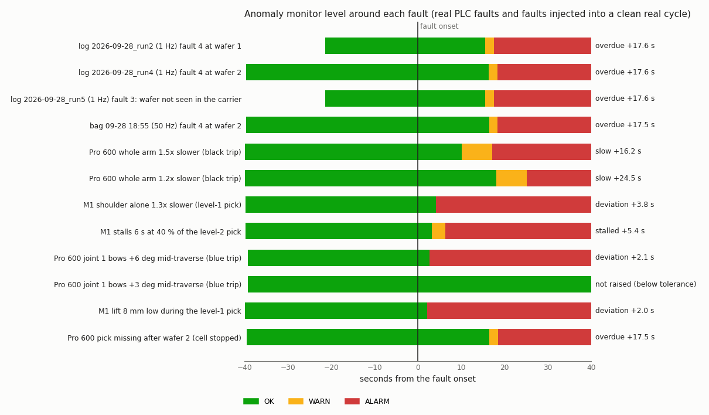
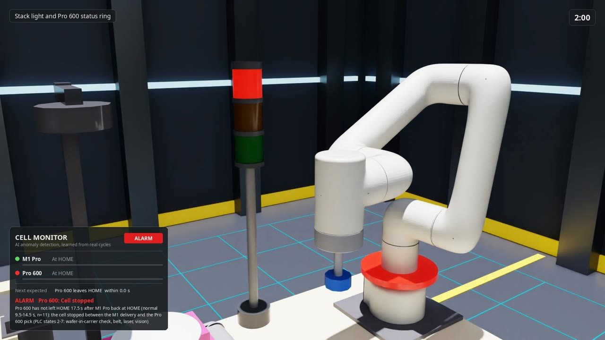

> **Before you start:** Read the [introduction, safety rules and network setup](/labs/lab-00-digital-twin/). The appendices this lab refers to are on the same page.

**Code repository:** [JatinSatyam26/wafer-cell-digital-twin](https://github.com/JatinSatyam26/wafer-cell-digital-twin) (commit `75990ed`)  
**Printable manual:** [Lab 5 (PDF)](/assets/Projects/Wafer-Cell-Digital-Twin/pdf/Lab5_FaultDetection.pdf)  
**Course data:** [course_materials.zip](https://github.com/JatinSatyam26/wafer-cell-digital-twin-labs/releases/download/v1.0/course_materials.zip) (unzip into your home folder as `~/course_materials/`)

## Lab Objective

In this lab you teach the twin what a normal cycle of the cell looks like, using real recordings, and then let it judge new motion from joint angles alone. You re-run the evaluation, inject a 6 s stall of the M1 into a real recording and measure how fast the twin reacts: a WARNING after 2.9 s and an ALARM after 5.4 s. You also read the cell's own fault log and replay a real stop in which the cell's camera reported no tape; the PLC stopped with fault 4; the twin flagged it from motion alone.

## 5.1 About Fault Detection from Motion

The twin from Labs 1 and 2 already receives the joint angles of both robots in real time. A twin that knows what *normal* looks like can also say when the real cell does something it has never done: an arm that is slow or stalled, an arm off its usual path, or a cell that has stopped.

The model is small and explicit on purpose. Two 50 Hz recordings and nine clean wafers are too few to train a deep model honestly, so the twin learns three simple things from the data:

- **Motion templates.** Each arm rests at HOME between jobs. A stretch away from HOME is an *excursion*. Similar excursions are grouped with dynamic time warping (DTW), which aligns two time series that run at slightly different speeds. The most central member of each group becomes the template for that trip.
- **Path tolerances.** Each joint may stray from its template by a set amount before the path counts as abnormal.
- **Learned time gaps.** The time between one arm's events (leave HOME, return HOME) and the next event is learned from clean runs.

From these, the monitor raises three main kinds of finding. A **path deviation** means a joint is outside its tolerance. A **lag** means the arm is behind its template; it is *stalled* if the arm has stopped where the template still moves, and *slow* otherwise. An **overdue** event means a tightly learned gap has run out, so the cell has probably stopped. Every alarm therefore traces back to one template, one tolerance or one gap.

The cell's programmable logic controller (PLC) has its own fault codes (the cell's original PLC program and bridge scripts; see Acknowledgments). Two of them matter in this lab. **Fault 3** means the carrier sensor did not detect the wafer within 5 s after the M1 placed it (state 2). **Fault 4** means the camera's colour rule wrote 3, "no tape", to `Vision_Result` (state 7). After a fault, the PLC holds every command at 0 until `Fault_Reset`. The full list of sequencer steps is in Appendix B.

Fault 4 records the camera's answer, so describe a fault-4 stop as the data show it: the cell's camera reported no tape; the PLC stopped with fault 4.

## 5.2 What You Need

**Prerequisites.** Lab 1 (the read-only bridge and its two topics `/telemetry/m1pro/joint_states` and `/telemetry/pro600/joint_states`) and Lab 2 (the live twin in Isaac Sim). You should be comfortable with Python and basic Robot Operating System 2 (ROS 2) terminal use.

*Table 5.1: Software for Lab 5*
| Item | Version |
|---|---|
| Operating system | Ubuntu 24.04.5 LTS |
| ROS 2 | Jazzy (`rclpy` 7.1.12); recordings are read with `rosbag2_py` |
| System Python | 3.12.3, NumPy 1.26.4, matplotlib 3.6.3 |
| Twin repository | `~/wafer-cell-digital-twin`, branch `main`, commit `75990ed` |
| Optional (Section 5.7, part C) | Isaac Sim 6.1.0; NVIDIA RTX 4060 Laptop GPU |

**Files.** The anomaly code lives in the repository under `tools/anomaly/`. The recordings (two recorded cycles and one overlapped cycle) and the cell's PLC log `cell_log.csv` are also in the repository. Your course folder `~/course_materials/lab5_fault_detection/` holds two helper scripts in `figures/` and the reference outputs in `data/`.

> **Note:** Sections 5.3–5.6 run on recorded data only. They need no graphics processing unit (GPU) and no hardware.

> **Warning:** This lab only reads data. No step commands a robot or the PLC. `replay_inject.py` publishes recorded joint angles on the telemetry topics, and no robot listens to them. Do not run it while the live bridge (`tools/live/live_telemetry.py`) is publishing, because the two sources mix. Never run Gazebo and Isaac Sim at the same time on the 8 GB laptop GPU. Never connect to the Pro 600 TCP port 5001 or the M1 ports 29999 and 30003.

## 5.3 Read the Cell's Faults

Before you judge the twin, find out from the PLC log what happened in the recorded runs.

1. Open `~/course_materials/cell_reference/plc/sequencer.stf` in a text editor.
2. Find where `Fault_Code := 3` is set (state 2) and where `Fault_Code := 4` is set (state 7).
3. List every faulted run in the cell's PLC logs:

```bash
cd ~/course_materials/lab5_fault_detection
python3 figures/scan_real_faults.py > data/real_faults_scan.txt
```

4. Open `data/real_faults_scan.txt`. The first faulted run shows the camera's answer arriving at state 7:

```text
  run 2026-09-28 #2  18:28:21 -> 18:30:15  Fault_Code [('4', 'vision no tape')]
     18:28:56.031 disk 1 step  7 inspecting               disk_in_carrier 1 vision 0 -
     18:29:37.450 disk 1 step  0 idle                     disk_in_carrier 0 vision 3 NO TAPE
     first row with the fault: 18:28:56.705 (1 Hz tick rows), disk 1, vision register 3 NO TAPE
```

The PLC entered state 7 at 18:28:56.031, and the vision register read 3 within 0.7 s. In the runs used for the evaluation, three runs stopped: Run 2 (fault 4, disk 1), Run 4 (fault 4, disk 2) and Run 5 (fault 3, disk 1). The file also lists three fault-3 stops from later sessions at the cell.

> **Tip:** Check: you can say which runs stopped because the camera reported no tape (fault 4) and which stopped because the carrier sensor did not see the wafer (fault 3).

## 5.4 Inspect the Normal Model and Its Rules

The committed model is `tools/anomaly/models/normal_cycle.json`. It was learned by `tools/anomaly/normal_model.py` from the 50 Hz recordings (templates) and from 5 clean runs in the PLC log, 9 wafers, plus a recorded overlapped cycle (time gaps). The three faulted runs are kept out of the gap training and serve as tests.

*Table 5.2: The four learned motion templates*
| Template | Trip | Duration | Examples |
|---|---|---|---|
| `m1pro_m1_wafer1` | M1, wafer 1 (rack level 1) | 20.7 s | 2 |
| `m1pro_m1_wafer2` | M1, wafer 2 (rack level 2) | 29.7 s | 2 |
| `pro600_p6_black_rack` | Pro 600 to the black rack | 20.4 s | 1 |
| `pro600_p6_blue_rack` | Pro 600 to the blue rack | 20.8 s | 2 |

**Tolerances.** Two examples of the same trip differ by at most 0.6° on the M1 and 1.6° on the Pro 600. Every tolerance therefore sits at its floor: 4 mm on the M1 lift, 2.0° (0.035 rad) on the other M1 joints and 3.4° (0.06 rad) on each Pro 600 joint. The floors come from how closely the twin tracked the real arms, with a margin.

**The key gap.** After the M1 returns from a delivery, the Pro 600 leaves HOME once the belt, the laser and the camera have finished. In the clean runs this gap was 9.46–14.54 s (n = 11).

**The lag rule.** Lag is the elapsed time minus the template time at the matched point. The monitor allows a normal spread that grows with the template time:

```python
    def _allow(self, tr, f):
        # normal spread: 20.4-20.8 s for the same trip (0.09 s per s), plus one sample period of start uncertainty
        return 1.0 + 0.03 * float(f.tpl.t[f.j]) + 1.5 * tr.dt
```

A lag above `allow + 1.5` s gives a WARNING, and a lag above `allow + 4.0` s gives an ALARM (`monitor.py`, `_check_motion()`).

**The overdue rule.** A tight learned gap starts a deadline for the next event on the other arm:

```python
                self.expect = {'t_from': t, 'from': ev, 'what': to, 'gap': g,
                               'warn': t + g['max'] + 1.0, 'alarm': t + g['max'] + max(self.margin, 0.2 * g['max'])}
```

With the largest gap of 14.54 s and the default margin of 3 s, the WARNING comes 15.54 s and the ALARM 17.54 s after the M1's return.

**Worked example.** The injected stall in Section 5.6 starts at 40 % of the 29.7 s level-2 template, about 11.9 s in. At 50 Hz the sample period is 0.02 s. The allowance is 1.0 + 0.03 × 11.9 + 1.5 × 0.02 = 1.39 s, so the WARNING threshold is a lag of 2.89 s and the ALARM threshold a lag of 5.39 s. A stalled arm falls behind by 1 s every second, so the WARNING should come 2.9 s and the ALARM 5.4 s after the stall begins.

## 5.5 Re-run the Evaluation

`evaluate.py` scores the monitor on the clean runs (each by a model learned without it), the real PLC faults and eight faults injected into the clean 18:03 recording.

1. Run the evaluation and the comparison:

```bash
cd ~/course_materials/lab5_fault_detection/data
source /opt/ros/jazzy/setup.bash
PYTHONDONTWRITEBYTECODE=1 python3 ~/wafer-cell-digital-twin/tools/anomaly/evaluate.py --out ~/course_materials/lab5_fault_detection/data/evaluate_rerun > evaluate_rerun_stdout.txt
diff <(grep -v '^wrote' evaluate_rerun_stdout.txt) <(grep -v '^wrote' ~/wafer-cell-digital-twin/docs/results/anomaly_detection/evaluate_output.txt)
```

2. Wait about 30 s; the expected run time is 28.9 s.
3. Open `evaluate_rerun_stdout.txt`. It has 23 result lines. These are representative:

```text
OK clean   log 2026-09-24_run1 (1 Hz, out of sample)    -> nothing raised
OK clean   bag 09-28 18:03 (50 Hz, in sample)           -> nothing raised
OK real    log 2026-09-28_run2 (1 Hz) fault 4 at wafer 1 -> overdue after 17.6 s
OK real    log 2026-09-28_run5 (1 Hz) fault 3: wafer not seen in the carrier -> overdue after 17.6 s
OK real    bag 09-28 18:55 (50 Hz) fault 4 at wafer 2   -> overdue after 17.5 s
OK inject  M1 stalls 6 s at 40 % of the level-2 pick    -> stalled after 5.4 s
!! inject  Pro 600 joint 1 bows +3 deg mid-traverse (blue trip) -> nothing raised
```

The `!!` line is expected: a 3° bow stays inside the Pro 600's 3.4° tolerance. The printed stall line gives the ALARM latency. The WARNING latency, 2.91 s, is the `detected.latency_s` of the stall case in `evaluate_rerun/results.json`.

> **Tip:** Check: the `diff` command prints nothing. All 23 result lines should be identical to the committed output.

> **Note:** Your `results.json` differs from the committed one only in message text: it says "normal 9.5-14.5 s, n=11", while the committed file, written before the overlapped cycle was added, says "13.8-14.5 s, n=9". All latencies and levels are the same, because the deadline uses the largest gap, 14.54 s, in both.

## 5.6 Plot the Injected Stall

The stall is an edit of a real recording. `evaluate.py` takes the clean 18:03 recording, finds the M1's level-2 pick (29.72 s) and, at 40 % of it, inserts 6 s of samples that repeat the pose of that instant. Every later M1 sample moves 6 s later, and so do the Pro 600's later samples, because the PLC would wait for the slow arm. The course script `figures/stall_plot.py` repeats this case and records the M1's lag and both thresholds every 0.25 s.

1. Run the plot script:

```bash
cd ~/course_materials/lab5_fault_detection
source /opt/ros/jazzy/setup.bash && PYTHONDONTWRITEBYTECODE=1 python3 figures/stall_plot.py
```

2. Compare the printout with `data/stall_plot_stdout.txt`. The key lines are:

```text
  finding  +2.91 s  WARN  stalled  m1pro: 2.9 s behind "m1pro_m1_wafer2" at 40 % - not moving
  finding  +5.41 s  ALARM stalled  m1pro: 5.4 s behind "m1pro_m1_wafer2" at 40 % - not moving
WARN latency 2.91 s, ALARM latency 5.41 s
findings in the clean bag without the stall: 0
```

3. Open `figures/stall_plot.png` (Figure 5.1).


*Figure 5.1: The injected 6 s stall of the M1 during the level-2 pick. The blue line is the M1's lag behind its template, and the dashed lines are the WARNING and ALARM thresholds. The lag rises 1 s per second during the stall and crosses the thresholds at +2.9 s and +5.4 s. The grey line is the same recording without the stall.*

4. Draw the status chart of every scenario from your evaluation results:

```bash
cd ~/course_materials/lab5_fault_detection
PYTHONDONTWRITEBYTECODE=1 python3 ~/wafer-cell-digital-twin/tools/anomaly/plot_results.py data/evaluate_rerun/results.json /tmp/levels.png
```

5. Open `/tmp/levels.png` and compare it with Figure 5.2. The two files should be byte-identical.


*Figure 5.2: Monitor level around each fault, for the real PLC faults and the faults injected into a clean real cycle. Green is OK, amber WARNING and red ALARM; time runs from the fault onset, and the right-hand labels give the first ALARM.*

> **Tip:** Check: WARNING at +2.9 s and ALARM at +5.4 s after the stall begins, and no finding in the same recording without the stall.

## 5.7 Replay Faults Through ROS 2

Now run the monitor as a ROS 2 node and feed it recordings in real time. The live bridge must not be running.

### A. Start the monitor

1. In terminal 1, start the node:

```bash
cd ~/wafer-cell-digital-twin
source /opt/ros/jazzy/setup.bash && python3 tools/anomaly/anomaly_node.py
```

2. Read its first log line. It lists the four templates of Table 5.2 and the learned gaps, including `m1pro.return->pro600.leave 9.5-14.5 s`.
3. In terminal 3, watch the overall level (0 OK, 1 WARNING, 2 ALARM):

```bash
ros2 topic echo /anomaly/level
```

### B. Replay the injected stall

1. In terminal 2, replay the clean recording with the stall:

```bash
cd ~/wafer-cell-digital-twin
source /opt/ros/jazzy/setup.bash && python3 tools/anomaly/replay_inject.py --bag bag_0928_1803 --inject stall --from 285 --to 370
```

2. Watch terminal 1. Expect these findings (your clock stamps will differ):

```text
[WARN] [1792657336.839268442] [anomaly_monitor]: WARN stalled: m1pro: 2.9 s behind "m1pro_m1_wafer2" at 40 % - not moving
[ERROR] [1792657339.343864833] [anomaly_monitor]: ALARM stalled: m1pro: 5.4 s behind "m1pro_m1_wafer2" at 40 % - not moving
```

The ALARM follows the WARNING about 2.5 s later, the same interval as offline (5.41 − 2.91 s).

### C. Replay the real fault-4 run

This replay plays the 18:55 recording (Run 4) from just before wafer 2. It also publishes the PLC step from the log, so the message can name the state.

1. In terminal 2, start the replay:

```bash
cd ~/wafer-cell-digital-twin
source /opt/ros/jazzy/setup.bash && python3 tools/anomaly/replay_inject.py --bag bag_0928_1855 --from 185 --to 285
```

2. Watch terminal 1. Expect a WARNING at 15.5 s and an ALARM at 17.6 s after the M1's return. The ALARM line reads:

```text
[ERROR] [1792656713.710845193] [anomaly_monitor]: ALARM overdue: pro600 has not left HOME 17.6 s after m1pro.return (normal 13.8-14.5 s, n=9): the cell stopped between the M1 delivery and the Pro 600 pick (PLC states 2-7: wafer-in-carrier check, belt, laser, vision); PLC at state 7 INSPECTING
```

> **Note:** This expected line comes from a log written with the earlier model, so it prints "normal 13.8-14.5 s, n=9". The current model prints "normal 9.5-14.5 s, n=11" in the same place. Both models share the largest gap, 14.54 s, so the deadlines are the same.

3. Optional, with a GPU: close any Gazebo session, then start the Isaac Sim twin with its anomaly overlay while a replay runs:

```bash
cd ~/wafer-cell-digital-twin
tools/isaac/run_isaac_live.sh --anomaly
```

The arm the finding concerns turns amber at a WARNING and red at an ALARM, and so does the stack light (Figure 5.3).


*Figure 5.3: Isaac Sim render of the replayed fault-4 run. The stack light and the Pro 600's status ring are red, and the Cell Monitor panel reads "ALARM Pro 600: Cell stopped": the Pro 600 has not left HOME 17.5 s after the M1 returned.*

> **Tip:** Check: you can state the fault-4 event in one line: the cell's camera reported no tape; the PLC stopped with fault 4; the twin flagged it from motion alone, because the Pro 600 never left HOME after the M1's delivery.

## 5.8 Results

*Table 5.3: Expected results*
| Scenario | Expected result |
|---|---|
| 5 clean log runs (1 Hz, out of sample) and the clean 18:03 recording (50 Hz, in sample) | No finding in 6 of 6 |
| Injected 6 s M1 stall at 40 % of the level-2 pick | WARNING *stalled* +2.91 s, ALARM +5.41 s |
| Thresholds at the stall point | WARNING at lag > 2.89 s, ALARM at lag > 5.39 s |
| Real fault 4, Run 2 (disk 1), 1 Hz log | WARNING +15.6 s, ALARM *overdue* +17.6 s |
| Real fault 4, Run 4 (disk 2), 1 Hz log and 50 Hz recording | ALARM +17.6 s (log), +17.5 s (recording) |
| Real fault 3, Run 5 (disk 1), 1 Hz log | ALARM +17.6 s |
| Other injected faults | Pro 600 1.5× slower: ALARM +16.2 s; 1.2× slower: ALARM +24.5 s; M1 shoulder 1.3× slower: ALARM +3.8 s; Pro 600 joint 1 bow +6°: ALARM +2.1 s; +3°: no finding (inside tolerance); M1 lift 8 mm low: ALARM +2.0 s; Pro 600 pick removed: ALARM +17.5 s |
| WARNING → ALARM, ROS 2 replay of the stall | 2.5 s |

Latencies for real faults count from the M1's return after its last delivery. The evaluated set holds three fault events: two fault-4 stops and one fault-3 stop. Run 4 is scored twice, from the log and from the recording. In both fault-4 runs, the cell's camera reported no tape; the PLC stopped with fault 4; the twin flagged it from motion alone. The monitor was built after these runs were recorded, so these detections come from replays. The same overdue rule has also run live beside the cell: in three runs that the PLC stopped with fault 3 (one in one later session at the cell, two in another), it raised an ALARM 17.5 s after the M1's return. Two of them are in `data/live_anomaly_log_2026-11-04.excerpt.txt`.

From joints alone, fault 3 and fault 4 look the same: the M1 delivers, and the Pro 600 never leaves HOME. Only the PLC step separates them ("state 2 M1_COMPLETE" or "state 7 INSPECTING"). The camera classifier of Lab 4 can answer that question directly at state 7.

*Table 5.4: Your results*
| Quantity | Your value |
|---|---|
| Clean runs with no finding (out of 6) | |
| Stall: WARNING latency (s) | |
| Stall: ALARM latency (s) | |
| Overdue ALARM for Runs 2, 4 and 5 (s) | |
| WARNING → ALARM interval in the ROS 2 replay (s) | |
| Output of the `diff` command in Section 5.5 | |

## 5.9 Troubleshooting

*Table 5.5: Troubleshooting*
| Problem | Likely cause | Fix |
|---|---|---|
| `ModuleNotFoundError: rosbag2_py` | ROS 2 is not sourced in this terminal | Run `source /opt/ros/jazzy/setup.bash` first |
| `evaluate.py` writes into the repository | `--out` decides where results go | Pass `--out` with a path outside the repository and run with `PYTHONDONTWRITEBYTECODE=1` |
| The monitor's states jump or mix | An old `anomaly_node.py` is still running | Run `ps -eo pid,args \| grep anomaly_node` and stop the old one by its process ID, not with `pkill -f` |
| WARNING "sequence: … an order never seen" at the start of the run after a fault reset | The faulted run ended on `m1pro.return`, and the next run begins with an order the clean runs never contained | Expected after a fault reset; acknowledge it and continue |
| Joint messages from two sources at once | `replay_inject.py` runs while the live bridge publishes | Stop one of them |

## 5.10 Check Your Understanding

1. What do Fault_Code 3 and Fault_Code 4 mean, and in which PLC state is each raised?
2. Compute the WARNING and ALARM lag thresholds for a stall at 80 % of the level-2 trip. Is it detected earlier or later after its onset than the stall at 40 %?
3. Why does the overdue ALARM come at 17.5 s and not just after the longest gap ever seen, 14.5 s? What would happen to false alarms with a 0.5 s margin?
4. The overlapped cycle widened the learned gap from 13.8–14.5 s to 9.5–14.5 s. Why did the detection latency stay the same?

## 5.11 Files Used in This Lab

*Table 5.6: Files used in this lab*
| File | Purpose |
|---|---|
| [`tools/anomaly/normal_model.py`](https://github.com/JatinSatyam26/wafer-cell-digital-twin/blob/75990ed/tools/anomaly/normal_model.py) | Learns the normal model: templates, tolerances and time gaps |
| [`tools/anomaly/models/normal_cycle.json`](https://github.com/JatinSatyam26/wafer-cell-digital-twin/blob/75990ed/tools/anomaly/models/normal_cycle.json) | The committed normal model |
| [`tools/anomaly/monitor.py`](https://github.com/JatinSatyam26/wafer-cell-digital-twin/blob/75990ed/tools/anomaly/monitor.py) | `CellMonitor`: the deviation, lag, overdue and sequence rules |
| [`tools/anomaly/evaluate.py`](https://github.com/JatinSatyam26/wafer-cell-digital-twin/blob/75990ed/tools/anomaly/evaluate.py) | Offline evaluation and the fault-injection functions |
| [`tools/anomaly/anomaly_node.py`](https://github.com/JatinSatyam26/wafer-cell-digital-twin/blob/75990ed/tools/anomaly/anomaly_node.py) | ROS 2 node; publishes `/anomaly/status` and `/anomaly/level` |
| [`tools/anomaly/replay_inject.py`](https://github.com/JatinSatyam26/wafer-cell-digital-twin/blob/75990ed/tools/anomaly/replay_inject.py) | Replays a recording in real time, with an optional injected fault |
| [`tools/anomaly/plot_results.py`](https://github.com/JatinSatyam26/wafer-cell-digital-twin/blob/75990ed/tools/anomaly/plot_results.py) | Status chart of `results.json` |
| [`tools/isaac/run_isaac_live.sh`](https://github.com/JatinSatyam26/wafer-cell-digital-twin/blob/75990ed/tools/isaac/run_isaac_live.sh) | Isaac Sim twin with the `--anomaly` overlay |
| `~/course_materials/lab5_fault_detection/figures/` | Course scripts `scan_real_faults.py` and `stall_plot.py` |
| `~/course_materials/cell_reference/plc/sequencer.stf` | The PLC sequencer and its fault codes |

Credits: see Acknowledgments.
