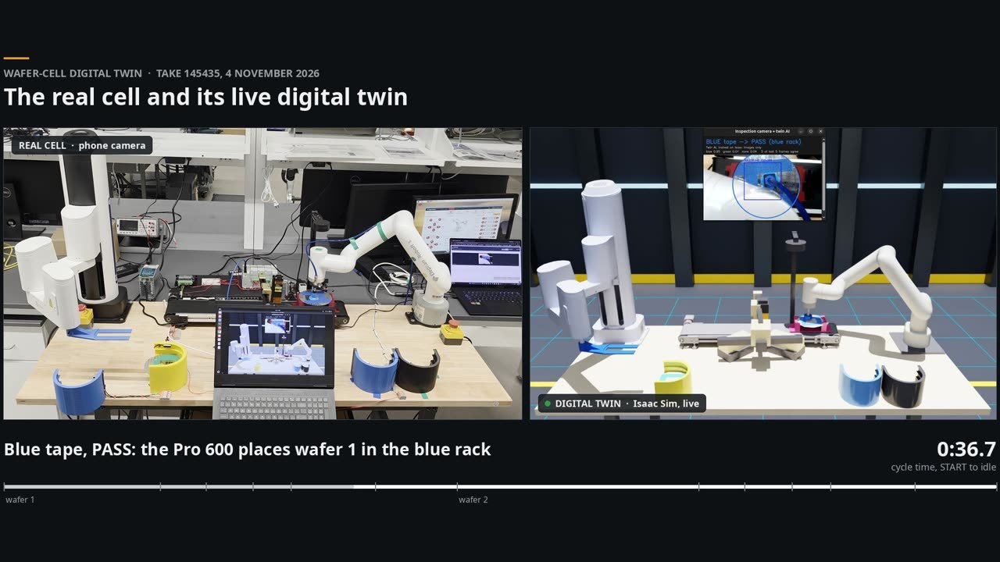

# Wafer-Cell Digital Twin

A live, read-only digital twin of a real two-robot wafer-handling cell at Arizona State University. The cell, in short: a Dobot M1 Pro SCARA loads glass wafers into a carrier on a conveyor, a laser station marks them, a camera checks each wafer's tape colour, and a myCobot Pro 600 sorts them into pass and reject racks, all sequenced by a Micro850 PLC.

The twin listens to the cell and never commands it. It:
- mirrors both robots live in NVIDIA Isaac Sim and Gazebo
- carries the wafers with real contact physics
- recognises them with a vision model trained only on synthetic images
- detects faults from robot motion alone
- was used to make the real cell 26 % faster

## Results reproduced in the labs

| Lab | Result |
|---|---|
| 1. Read-only bridge | Both robots streamed live into ROS 2 at 50 Hz, with nothing ever written to the cell |
| 2. Live digital twin | Isaac Sim tracks the live joint data within 0.50° (M1 Pro) and 2.20° (Pro 600) |
| 3. Contact physics | A 2.6 mm wafer slide predicted at μ 0.3; 2.1 mm (twice) and 2.5 mm measured on the cell |
| 4. Vision trained in simulation | 92.6 % (126 of 136) on real camera images, trained on synthetic images only |
| 5. Fault detection from motion | Injected 6 s stall: warning after 2.9 s, alarm after 5.4 s |
| 6. A faster real cell | Two-wafer cycle cut from 139.9 s to 103.9 s (−26 %), 3 of 3 runs |

## Links

- Lab pages: start at [`/labs/lab-00-digital-twin/`](/labs/lab-00-digital-twin/)
- Printable manuals: [full manual](pdf/WaferCell_DigitalTwin_LabManual_Full.pdf) and one PDF per lab in [`pdf/`](pdf/)
- Twin code: https://github.com/JatinSatyam26/wafer-cell-digital-twin
- Course data: [course_materials.zip](https://github.com/JatinSatyam26/wafer-cell-digital-twin-labs/releases/download/v1.0/course_materials.zip)

## Credits

This work was carried out at Arizona State University under the guidance of Dr. Sangram Redkar. The wafer-handling cell that the twin observes, its PLC program, and its robot bridge scripts were built and written by Alonso Preciado Martinez. Digital twin and labs: Jatin Satyam.
